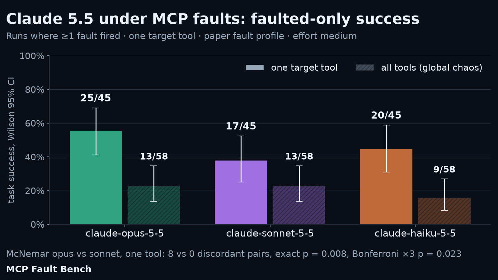
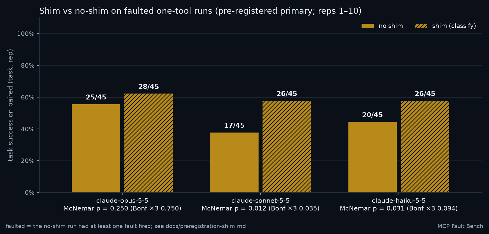
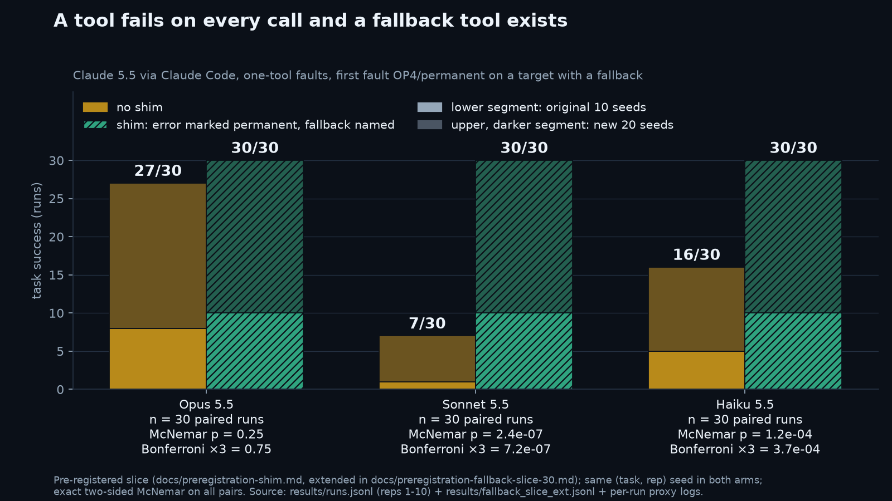
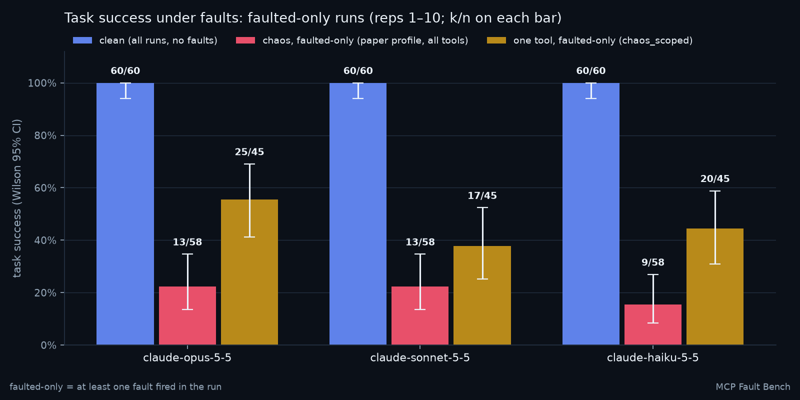
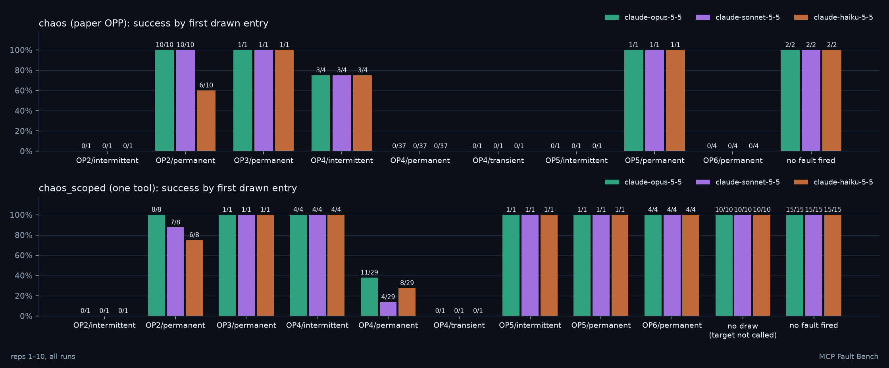
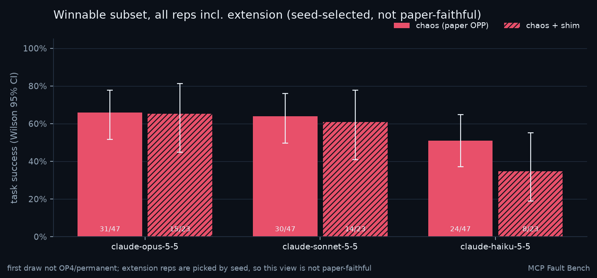

# MCP Fault Bench

An ongoing benchmark of LLM agents under the realistic MCP fault profile of Iannillo et al. (NeurIPS 2026, [arXiv:2610.32555](https://arxiv.org/abs/2610.32555)) on six small local tasks. It runs in rounds: each round puts a model family's agent through the same tasks, fault profiles, seeds and grading, so rounds stay comparable. Round 1 is Claude 5.5 (opus, sonnet and haiku 5.5, effort medium) running as the Claude Code agent. Every result number below is generated from `results/summary.json`; paper numbers are quoted from the paper. To run a new model family, see [Adding a model](#adding-a-model).

## Results: Claude 5.5 (round 1)

Agent: Claude Code (`--adapter claude-code`); models `claude-opus-5-5`, `claude-sonnet-5-5`, `claude-haiku-5-5`; effort medium. Records: `results/runs.jsonl` and `results/fallback_slice_ext.jsonl`. How these numbers differ from the paper's: [Not directly comparable with the paper](#not-directly-comparable-with-the-paper).

<!-- LEAD:START -->
Generated by `scripts/render_results.py` from `results/summary.json`: reps 1–10, the paper-weighted sample (540 runs; `claude-opus-5-5`, `claude-sonnet-5-5`, `claude-haiku-5-5`; effort medium; agent Claude Code; 6 small local tasks). Extension reps (seed-selected, not paper-faithful) never enter these numbers.

Counting only one-tool runs where at least one fault fired, Claude 5.5 task success is opus 25/45, sonnet 17/45, haiku 20/45. Across all runs (including runs where no fault fired), success falls from 100% clean to 18%–25% when every tool can fault under the paper's fault profile, and to 53%–67% when faults hit one target tool. On the same (task, rep) draws, opus beat sonnet 8 times and lost 0 times (exact McNemar p = 0.008).

**Faulted-only** (runs where at least one fault fired; Wilson 95% CI; reps 1–10)

| Model | One-tool faulted-only: success / n | 95% CI | Chaos (all tools) faulted-only: success / n | 95% CI |
|---|---:|---|---:|---|
| claude-opus-5-5 | 25/45 (56%) | 41%–69% | 13/58 (22%) | 14%–35% |
| claude-sonnet-5-5 | 17/45 (38%) | 25%–52% | 13/58 (22%) | 14%–35% |
| claude-haiku-5-5 | 20/45 (44%) | 31%–59% | 9/58 (16%) | 8%–27% |

**All runs, including runs where no fault fired** (paper fault profile; success / n per cell, reps 1–10)

| Model | clean | chaos (paper profile, all tools) | one-tool (chaos_scoped) |
|---|---:|---:|---:|
| claude-opus-5-5 | 60/60 (100%) | 15/60 (25%) | 40/60 (67%) |
| claude-sonnet-5-5 | 60/60 (100%) | 15/60 (25%) | 32/60 (53%) |
| claude-haiku-5-5 | 60/60 (100%) | 11/60 (18%) | 35/60 (58%) |

**Headline between-model test:** claude-opus-5-5 vs claude-sonnet-5-5, one-tool condition, 60 pairs on (task, rep). Discordant pairs 8 vs 0; exact two-sided McNemar p = 0.008; Bonferroni ×3 p = 0.023 (family: the 3 model pairs within the one-tool condition); Bonferroni ×9 p = 0.070 (family: 3 pairs × 3 conditions). The faulted-only scope (both runs faulted) gives the same discordant pairs. All pairs and conditions: [between-model McNemar](#between-model-mcnemar-reps-110).

**Pre-registered resilience shim:** results below; see [Resilience shim](#resilience-shim).
<!-- LEAD:END -->



### Resilience shim

The evaluated shim does **permanent-error classification plus a fallback hint**. It does not retry and does not back off. Every agent call is forwarded once, unchanged; the shim only rewrites the error text the agent sees. An auth, permission or not-found error (this pattern matches the injector's OP4 text for every persistence), a call with no response within `attempt_timeout_s`, or the same tool's second other error in a row comes back as `PERMANENT: <tool> failed (…). Do not retry <tool>; it will not recover in this session. Use fallback tool <X> instead.` (or, with no fallback left, a hint to complete what it can and report the rest).

The shim, its conditions, the primary analysis (one-tool condition, faulted-only on the no-shim run, exact McNemar per model, Bonferroni ×3) and the predictions were pre-registered in [docs/preregistration-shim.md](docs/preregistration-shim.md) before any shim evaluation run. Implementation: [Shim implementation](#shim-implementation-opt-in).

<!-- SHIM:START -->
Generated by `scripts/render_results.py` from `results/summary.json`. Pre-registration: [docs/preregistration-shim.md](docs/preregistration-shim.md). Config: [`profiles/shim.yaml`](profiles/shim.yaml) (classify mode).

Reps 1–10, paired on (task, rep). b = shim ✓ no-shim ✗, c = shim ✗ no-shim ✓; p = exact two-sided McNemar; Bonferroni ×3 across models. **Primary (confirmatory): chaos_scoped_shim vs chaos_scoped, pairs whose no-shim run had faults > 0.** The other rows are secondary.

| Comparison | Model | Population | Pairs | No-shim ✓ | Shim ✓ | b | c | p | Bonf ×3 | Median wall no-shim | Median wall shim |
|---|---|---|---:|---:|---:|---:|---:|---:|---:|---:|---:|
| chaos_scoped_shim vs chaos_scoped (primary) | claude-opus-5-5 | faulted-only (no-shim) | 45 | 25 | 28 | 3 | 0 | 0.250 | 0.750 | 17s | 16s |
| chaos_scoped_shim vs chaos_scoped (primary) | claude-sonnet-5-5 | faulted-only (no-shim) | 45 | 17 | 26 | 10 | 1 | 0.012 | 0.035 | 13s | 15s |
| chaos_scoped_shim vs chaos_scoped (primary) | claude-haiku-5-5 | faulted-only (no-shim) | 45 | 20 | 26 | 6 | 0 | 0.031 | 0.094 | 10s | 11s |
| chaos_shim vs chaos | claude-opus-5-5 | faulted-only (no-shim) | 58 | 13 | 13 | 0 | 0 | 1.000 | 1.000 | 14s | 14s |
| chaos_shim vs chaos | claude-sonnet-5-5 | faulted-only (no-shim) | 58 | 13 | 12 | 0 | 1 | 1.000 | 1.000 | 10s | 12s |
| chaos_shim vs chaos | claude-haiku-5-5 | faulted-only (no-shim) | 58 | 9 | 6 | 1 | 4 | 0.375 | 1.000 | 8s | 8s |
| clean_shim vs clean | claude-opus-5-5 | all pairs | 60 | 60 | 60 | 0 | 0 | 1.000 | 1.000 | 12s | 12s |
| clean_shim vs clean | claude-sonnet-5-5 | all pairs | 60 | 60 | 60 | 0 | 0 | 1.000 | 1.000 | 12s | 13s |
| clean_shim vs clean | claude-haiku-5-5 | all pairs | 60 | 60 | 60 | 0 | 0 | 1.000 | 1.000 | 7s | 8s |

#### Predictions vs results

The slice and prediction columns are copied from the pre-registration. Result cells are generated: no-shim → shim successes on the paired (task, rep), faulted-only on the no-shim run except Clean; p = exact two-sided McNemar for single slices. Rows that pool several first entries show counts only.

| Slice (pre-registered) | Prediction (pre-registered, static text) | Result: claude-opus-5-5 | Result: claude-sonnet-5-5 | Result: claude-haiku-5-5 |
|---|---|---|---|---|
| OP4/permanent, fallback-eligible target, n = 10 per model | Lift for all three. Largest for sonnet (we expect ≥ 5/10) and haiku; little room for opus. | no-shim 8/10 → shim 10/10, b 2 c 0, p = 0.500, median wall 16s → 17s | no-shim 1/10 → shim 10/10, b 9 c 0, p = 0.004, median wall 10s → 18s | no-shim 5/10 → shim 10/10, b 5 c 0, p = 0.062, median wall 11s → 12s |
| OP4/permanent, no fallback available (19 per model) | No success change: the task's data is unreachable. Possibly fewer calls and shorter runs. | no-shim 3/19 → shim 3/19, b 0 c 0, p = 1.000, median wall 16s → 14s | no-shim 3/19 → shim 3/19, b 0 c 0, p = 1.000, median wall 12s → 15s | no-shim 3/19 → shim 3/19, b 0 c 0, p = 1.000, median wall 9s → 10s |
| OP4 intermittent or transient | Possible harm: a recoverable error gets labelled PERMANENT. Too few runs to test. | no-shim 0/1 → shim 0/1, b 0 c 0, p = 1.000, median wall 10s → 17s | no-shim 0/1 → shim 0/1, b 0 c 0, p = 1.000, median wall 14s → 12s | no-shim 0/1 → shim 0/1, b 0 c 0, p = 1.000, median wall 9s → 7s |
| OP6/permanent | Same success, shorter wall time (35 s vs 60 s per hung call). | no-shim 4/4 → shim 4/4, b 0 c 0, p = 1.000, median wall 249s → 149s | no-shim 4/4 → shim 4/4, b 0 c 0, p = 1.000, median wall 248s → 150s | no-shim 4/4 → shim 4/4, b 0 c 0, p = 1.000, median wall 246s → 146s |
| OP1/OP2/OP3/OP5 | No effect: the shim does not touch successful responses. | no-shim 10/11 → shim 11/11 (pooled, no test) | no-shim 9/11 → shim 9/11 (pooled, no test) | no-shim 8/11 → shim 9/11 (pooled, no test) |
| All faulted one-tool runs (n = 45 per model) | Positive lift for sonnet (primary hypothesis) and haiku; about zero for opus. | no-shim 25/45 → shim 28/45, b 3 c 0, p = 0.250, median wall 17s → 16s | no-shim 17/45 → shim 26/45, b 10 c 1, p = 0.012, median wall 13s → 15s | no-shim 20/45 → shim 26/45, b 6 c 0, p = 0.031, median wall 10s → 11s |
| Global chaos, OP4/permanent | Stays at about 0: every tool is denied, so no fallback works. | no-shim 0/37 → shim 0/37, b 0 c 0, p = 1.000, median wall 12s → 12s | no-shim 0/37 → shim 0/37, b 0 c 0, p = 1.000, median wall 8s → 10s | no-shim 0/37 → shim 0/37, b 0 c 0, p = 1.000, median wall 7s → 8s |
| Clean | No change. | no-shim 60/60 → shim 60/60, b 0 c 0, p = 1.000, median wall 12s → 12s | no-shim 60/60 → shim 60/60, b 0 c 0, p = 1.000, median wall 12s → 13s | no-shim 60/60 → shim 60/60, b 0 c 0, p = 1.000, median wall 7s → 8s |

#### What the agent did after an error on the target

Generated from the Claude Code stream of each run, faulted pairs only. A retry is a call with the same tool and the same arguments issued after that call's error result came back; calls in one parallel batch are issued before any result returns, so they are not retries. "Repeating a target call" counts any repeat of a (target, arguments) pair, including ones issued before an error came back. After the target's first error a run either stopped (no retry, no fallback), called a fallback named in [`profiles/shim.yaml`](profiles/shim.yaml), retried, or both; successes in brackets.

| Model | Arm | Faulted pairs | Runs repeating a target call (same args) | Runs retrying after an error | Retry calls (any tool) | Target errored | Stopped (succ.) | Fallback (succ.) | Retried (succ.) | Both (succ.) |
|---|---|---:|---:|---:|---:|---:|---:|---:|---:|---:|
| claude-opus-5-5 | no shim | 45 | 9 | 5 | 7 | 35 | 19 (4) | 11 (10) | 4 (0) | 1 (1) |
| claude-opus-5-5 | shim | 45 | 3 | 0 | 0 | 35 | 22 (5) | 13 (13) | 0 (0) | 0 (0) |
| claude-sonnet-5-5 | no shim | 45 | 3 | 1 | 2 | 35 | 30 (4) | 4 (4) | 1 (0) | 0 (0) |
| claude-sonnet-5-5 | shim | 45 | 2 | 0 | 0 | 35 | 22 (5) | 13 (13) | 0 (0) | 0 (0) |
| claude-haiku-5-5 | no shim | 45 | 14 | 12 | 18 | 35 | 17 (2) | 6 (6) | 5 (2) | 7 (2) |
| claude-haiku-5-5 | shim | 45 | 4 | 0 | 0 | 35 | 22 (4) | 13 (13) | 0 (0) | 0 (0) |

OP4/permanent first draw × fallback-eligible target (the pre-registered slice; first entry and target taken from the no-shim run; targets get_price, get_price_v2, get_note, list_notes):

| Model | Arm | Runs | Target errored | Stopped (succ.) | Fallback (succ.) | Retried (succ.) | Both (succ.) |
|---|---|---:|---:|---:|---:|---:|---:|
| claude-opus-5-5 | no shim | 10 | 10 | 1 (0) | 8 (7) | 0 (0) | 1 (1) |
| claude-opus-5-5 | shim | 10 | 10 | 0 (0) | 10 (10) | 0 (0) | 0 (0) |
| claude-sonnet-5-5 | no shim | 10 | 10 | 9 (0) | 1 (1) | 0 (0) | 0 (0) |
| claude-sonnet-5-5 | shim | 10 | 10 | 0 (0) | 10 (10) | 0 (0) | 0 (0) |
| claude-haiku-5-5 | no shim | 10 | 10 | 0 (0) | 4 (4) | 0 (0) | 6 (1) |
| claude-haiku-5-5 | shim | 10 | 10 | 0 (0) | 10 (10) | 0 (0) | 0 (0) |

<details><summary>Secondary slices (not confirmatory)</summary>

Secondary slices (not confirmatory). First entry and fallback-eligible target (get_price, get_price_v2, get_note, list_notes) are taken from the no-shim run, within the faulted-only population.

| Comparison | Model | Slice | Pairs | No-shim ✓ | Shim ✓ | b | c | p | Median wall no-shim | Median wall shim |
|---|---|---|---:|---:|---:|---:|---:|---:|---:|---:|
| chaos_scoped_shim vs chaos_scoped | claude-opus-5-5 | first entry OP2/intermittent | 1 | 0 | 1 | 1 | 0 | 1.000 | 266s | 54s |
| chaos_scoped_shim vs chaos_scoped | claude-opus-5-5 | first entry OP2/permanent | 8 | 8 | 8 | 0 | 0 | 1.000 | 19s | 15s |
| chaos_scoped_shim vs chaos_scoped | claude-opus-5-5 | first entry OP3/permanent | 1 | 1 | 1 | 0 | 0 | 1.000 | 16s | 13s |
| chaos_scoped_shim vs chaos_scoped | claude-opus-5-5 | first entry OP4/permanent | 29 | 11 | 13 | 2 | 0 | 0.500 | 16s | 16s |
| chaos_scoped_shim vs chaos_scoped | claude-opus-5-5 | first entry OP4/transient | 1 | 0 | 0 | 0 | 0 | 1.000 | 10s | 17s |
| chaos_scoped_shim vs chaos_scoped | claude-opus-5-5 | first entry OP5/permanent | 1 | 1 | 1 | 0 | 0 | 1.000 | 130s | 130s |
| chaos_scoped_shim vs chaos_scoped | claude-opus-5-5 | first entry OP6/permanent | 4 | 4 | 4 | 0 | 0 | 1.000 | 249s | 149s |
| chaos_scoped_shim vs chaos_scoped | claude-opus-5-5 | target eligible | 20 | 18 | 20 | 2 | 0 | 0.500 | 19s | 17s |
| chaos_scoped_shim vs chaos_scoped | claude-opus-5-5 | target not eligible | 25 | 7 | 8 | 1 | 0 | 1.000 | 16s | 15s |
| chaos_scoped_shim vs chaos_scoped | claude-opus-5-5 | OP4/permanent first draw × fallback-eligible target | 10 | 8 | 10 | 2 | 0 | 0.500 | 16s | 17s |
| chaos_scoped_shim vs chaos_scoped | claude-opus-5-5 | OP4/permanent × no fallback | 19 | 3 | 3 | 0 | 0 | 1.000 | 16s | 14s |
| chaos_scoped_shim vs chaos_scoped | claude-opus-5-5 | both faulted | 45 | 25 | 28 | 3 | 0 | 0.250 | 17s | 16s |
| chaos_scoped_shim vs chaos_scoped | claude-opus-5-5 | all pairs | 60 | 40 | 43 | 3 | 0 | 0.250 | 16s | 15s |
| chaos_scoped_shim vs chaos_scoped | claude-sonnet-5-5 | first entry OP2/intermittent | 1 | 0 | 1 | 1 | 0 | 1.000 | 201s | 56s |
| chaos_scoped_shim vs chaos_scoped | claude-sonnet-5-5 | first entry OP2/permanent | 8 | 7 | 6 | 0 | 1 | 1.000 | 15s | 14s |
| chaos_scoped_shim vs chaos_scoped | claude-sonnet-5-5 | first entry OP3/permanent | 1 | 1 | 1 | 0 | 0 | 1.000 | 10s | 15s |
| chaos_scoped_shim vs chaos_scoped | claude-sonnet-5-5 | first entry OP4/permanent | 29 | 4 | 13 | 9 | 0 | 0.004 | 12s | 15s |
| chaos_scoped_shim vs chaos_scoped | claude-sonnet-5-5 | first entry OP4/transient | 1 | 0 | 0 | 0 | 0 | 1.000 | 14s | 12s |
| chaos_scoped_shim vs chaos_scoped | claude-sonnet-5-5 | first entry OP5/permanent | 1 | 1 | 1 | 0 | 0 | 1.000 | 134s | 134s |
| chaos_scoped_shim vs chaos_scoped | claude-sonnet-5-5 | first entry OP6/permanent | 4 | 4 | 4 | 0 | 0 | 1.000 | 248s | 150s |
| chaos_scoped_shim vs chaos_scoped | claude-sonnet-5-5 | target eligible | 20 | 10 | 18 | 9 | 1 | 0.021 | 14s | 16s |
| chaos_scoped_shim vs chaos_scoped | claude-sonnet-5-5 | target not eligible | 25 | 7 | 8 | 1 | 0 | 1.000 | 13s | 15s |
| chaos_scoped_shim vs chaos_scoped | claude-sonnet-5-5 | OP4/permanent first draw × fallback-eligible target | 10 | 1 | 10 | 9 | 0 | 0.004 | 10s | 18s |
| chaos_scoped_shim vs chaos_scoped | claude-sonnet-5-5 | OP4/permanent × no fallback | 19 | 3 | 3 | 0 | 0 | 1.000 | 12s | 15s |
| chaos_scoped_shim vs chaos_scoped | claude-sonnet-5-5 | both faulted | 45 | 17 | 26 | 10 | 1 | 0.012 | 13s | 15s |
| chaos_scoped_shim vs chaos_scoped | claude-sonnet-5-5 | all pairs | 60 | 32 | 41 | 10 | 1 | 0.012 | 12s | 14s |
| chaos_scoped_shim vs chaos_scoped | claude-haiku-5-5 | first entry OP2/intermittent | 1 | 0 | 0 | 0 | 0 | 1.000 | 317s | 54s |
| chaos_scoped_shim vs chaos_scoped | claude-haiku-5-5 | first entry OP2/permanent | 8 | 6 | 7 | 1 | 0 | 1.000 | 12s | 11s |
| chaos_scoped_shim vs chaos_scoped | claude-haiku-5-5 | first entry OP3/permanent | 1 | 1 | 1 | 0 | 0 | 1.000 | 8s | 9s |
| chaos_scoped_shim vs chaos_scoped | claude-haiku-5-5 | first entry OP4/permanent | 29 | 8 | 13 | 5 | 0 | 0.062 | 9s | 10s |
| chaos_scoped_shim vs chaos_scoped | claude-haiku-5-5 | first entry OP4/transient | 1 | 0 | 0 | 0 | 0 | 1.000 | 9s | 7s |
| chaos_scoped_shim vs chaos_scoped | claude-haiku-5-5 | first entry OP5/permanent | 1 | 1 | 1 | 0 | 0 | 1.000 | 128s | 129s |
| chaos_scoped_shim vs chaos_scoped | claude-haiku-5-5 | first entry OP6/permanent | 4 | 4 | 4 | 0 | 0 | 1.000 | 246s | 146s |
| chaos_scoped_shim vs chaos_scoped | claude-haiku-5-5 | target eligible | 20 | 13 | 19 | 6 | 0 | 0.031 | 12s | 12s |
| chaos_scoped_shim vs chaos_scoped | claude-haiku-5-5 | target not eligible | 25 | 7 | 7 | 0 | 0 | 1.000 | 9s | 10s |
| chaos_scoped_shim vs chaos_scoped | claude-haiku-5-5 | OP4/permanent first draw × fallback-eligible target | 10 | 5 | 10 | 5 | 0 | 0.062 | 11s | 12s |
| chaos_scoped_shim vs chaos_scoped | claude-haiku-5-5 | OP4/permanent × no fallback | 19 | 3 | 3 | 0 | 0 | 1.000 | 9s | 10s |
| chaos_scoped_shim vs chaos_scoped | claude-haiku-5-5 | both faulted | 45 | 20 | 26 | 6 | 0 | 0.031 | 10s | 11s |
| chaos_scoped_shim vs chaos_scoped | claude-haiku-5-5 | all pairs | 60 | 35 | 41 | 6 | 0 | 0.031 | 9s | 10s |
| chaos_shim vs chaos | claude-opus-5-5 | first entry OP2/intermittent | 1 | 0 | 0 | 0 | 0 | 1.000 | 600s | 300s |
| chaos_shim vs chaos | claude-opus-5-5 | first entry OP2/permanent | 10 | 10 | 10 | 0 | 0 | 1.000 | 25s | 29s |
| chaos_shim vs chaos | claude-opus-5-5 | first entry OP3/permanent | 1 | 1 | 1 | 0 | 0 | 1.000 | 14s | 14s |
| chaos_shim vs chaos | claude-opus-5-5 | first entry OP4/intermittent | 2 | 1 | 1 | 0 | 0 | 1.000 | 33s | 21s |
| chaos_shim vs chaos | claude-opus-5-5 | first entry OP4/permanent | 37 | 0 | 0 | 0 | 0 | 1.000 | 12s | 12s |
| chaos_shim vs chaos | claude-opus-5-5 | first entry OP4/transient | 1 | 0 | 0 | 0 | 0 | 1.000 | 12s | 8s |
| chaos_shim vs chaos | claude-opus-5-5 | first entry OP5/intermittent | 1 | 0 | 0 | 0 | 0 | 1.000 | 17s | 16s |
| chaos_shim vs chaos | claude-opus-5-5 | first entry OP5/permanent | 1 | 1 | 1 | 0 | 0 | 1.000 | 340s | 342s |
| chaos_shim vs chaos | claude-opus-5-5 | first entry OP6/permanent | 4 | 0 | 0 | 0 | 0 | 1.000 | 456s | 238s |
| chaos_shim vs chaos | claude-opus-5-5 | both faulted | 58 | 13 | 13 | 0 | 0 | 1.000 | 14s | 14s |
| chaos_shim vs chaos | claude-opus-5-5 | all pairs | 60 | 15 | 15 | 0 | 0 | 1.000 | 14s | 14s |
| chaos_shim vs chaos | claude-sonnet-5-5 | first entry OP2/intermittent | 1 | 0 | 0 | 0 | 0 | 1.000 | 600s | 263s |
| chaos_shim vs chaos | claude-sonnet-5-5 | first entry OP2/permanent | 10 | 10 | 9 | 0 | 1 | 1.000 | 16s | 20s |
| chaos_shim vs chaos | claude-sonnet-5-5 | first entry OP3/permanent | 1 | 1 | 1 | 0 | 0 | 1.000 | 21s | 14s |
| chaos_shim vs chaos | claude-sonnet-5-5 | first entry OP4/intermittent | 2 | 1 | 1 | 0 | 0 | 1.000 | 32s | 16s |
| chaos_shim vs chaos | claude-sonnet-5-5 | first entry OP4/permanent | 37 | 0 | 0 | 0 | 0 | 1.000 | 8s | 10s |
| chaos_shim vs chaos | claude-sonnet-5-5 | first entry OP4/transient | 1 | 0 | 0 | 0 | 0 | 1.000 | 8s | 7s |
| chaos_shim vs chaos | claude-sonnet-5-5 | first entry OP5/intermittent | 1 | 0 | 0 | 0 | 0 | 1.000 | 11s | 20s |
| chaos_shim vs chaos | claude-sonnet-5-5 | first entry OP5/permanent | 1 | 1 | 1 | 0 | 0 | 1.000 | 346s | 349s |
| chaos_shim vs chaos | claude-sonnet-5-5 | first entry OP6/permanent | 4 | 0 | 0 | 0 | 0 | 1.000 | 399s | 204s |
| chaos_shim vs chaos | claude-sonnet-5-5 | both faulted | 58 | 13 | 12 | 0 | 1 | 1.000 | 10s | 12s |
| chaos_shim vs chaos | claude-sonnet-5-5 | all pairs | 60 | 15 | 14 | 0 | 1 | 1.000 | 10s | 12s |
| chaos_shim vs chaos | claude-haiku-5-5 | first entry OP2/intermittent | 1 | 0 | 0 | 0 | 0 | 1.000 | 600s | 259s |
| chaos_shim vs chaos | claude-haiku-5-5 | first entry OP2/permanent | 10 | 6 | 3 | 1 | 4 | 0.375 | 14s | 13s |
| chaos_shim vs chaos | claude-haiku-5-5 | first entry OP3/permanent | 1 | 1 | 1 | 0 | 0 | 1.000 | 10s | 9s |
| chaos_shim vs chaos | claude-haiku-5-5 | first entry OP4/intermittent | 2 | 1 | 1 | 0 | 0 | 1.000 | 21s | 18s |
| chaos_shim vs chaos | claude-haiku-5-5 | first entry OP4/permanent | 37 | 0 | 0 | 0 | 0 | 1.000 | 7s | 8s |
| chaos_shim vs chaos | claude-haiku-5-5 | first entry OP4/transient | 1 | 0 | 0 | 0 | 0 | 1.000 | 7s | 7s |
| chaos_shim vs chaos | claude-haiku-5-5 | first entry OP5/intermittent | 1 | 0 | 0 | 0 | 0 | 1.000 | 11s | 12s |
| chaos_shim vs chaos | claude-haiku-5-5 | first entry OP5/permanent | 1 | 1 | 1 | 0 | 0 | 1.000 | 338s | 338s |
| chaos_shim vs chaos | claude-haiku-5-5 | first entry OP6/permanent | 4 | 0 | 0 | 0 | 0 | 1.000 | 399s | 200s |
| chaos_shim vs chaos | claude-haiku-5-5 | both faulted | 58 | 9 | 6 | 1 | 4 | 0.375 | 8s | 8s |
| chaos_shim vs chaos | claude-haiku-5-5 | all pairs | 60 | 11 | 8 | 1 | 4 | 0.375 | 8s | 8s |

</details>


<!-- SHIM:END -->

#### Fallback slice: 30 paired seeds

The fallback slice is the set of one-tool (`chaos_scoped`) runs whose first fault is OP4/permanent (the target tool errors on every call) on a target that has a fallback in `profiles/shim.yaml`. Each no-shim run is paired with the `chaos_scoped_shim` run on the same (task, model, rep) seed. The original slice had 10 seeds per model (reps 1–10), and their shim results were already known. Before any new run, [the extension pre-registration](docs/preregistration-fallback-slice-30.md) fixed 20 new seeds (reps ≥ 11, listed in `bench/fallback_slice_reps.json`). They were chosen by `scripts/select_fallback_slice_seeds.py` from seed strings, profiles and clean-run records only, never from a chaos outcome. The test is an exact two-sided McNemar per model, with b = shim-only successes, c = no-shim-only successes, and Bonferroni ×3 across models. `scripts/plot_fallback_slice.py` recomputes everything from `results/runs.jsonl` (original 10) and `results/fallback_slice_ext.jsonl` (new 20) plus the per-run proxy logs, and writes `results/fallback_slice_30.json`.

| Model | Block | Pairs | No-shim success | Shim success | b | c | McNemar p | Bonferroni ×3 |
|---|---|---|---|---|---|---|---|---|
| Opus 5.5 | original 10 | 10 | 8/10 | 10/10 | 2 | 0 | 0.5 | 1 |
| Opus 5.5 | new 20 | 20 | 19/20 | 20/20 | 1 | 0 | 1 | 1 |
| Opus 5.5 | all 30 | 30 | 27/30 | 30/30 | 3 | 0 | 0.25 | 0.75 |
| Sonnet 5.5 | original 10 | 10 | 1/10 | 10/10 | 9 | 0 | 0.00391 | 0.0117 |
| Sonnet 5.5 | new 20 | 20 | 6/20 | 20/20 | 14 | 0 | 1.2e-04 | 3.7e-04 |
| Sonnet 5.5 | all 30 | 30 | 7/30 | 30/30 | 23 | 0 | 2.4e-07 | 7.2e-07 |
| Haiku 5.5 | original 10 | 10 | 5/10 | 10/10 | 5 | 0 | 0.0625 | 0.188 |
| Haiku 5.5 | new 20 | 20 | 11/20 | 20/20 | 9 | 0 | 0.00391 | 0.0117 |
| Haiku 5.5 | all 30 | 30 | 16/30 | 30/30 | 14 | 0 | 1.2e-04 | 3.7e-04 |



With the shim, all three models succeeded on all 30 seeds, and no pair went the other way (c = 0 everywhere). On the new 20 seeds alone, which are the clean replication, the lift is significant after Bonferroni for sonnet (6/20 → 20/20) and haiku (11/20 → 20/20). Opus succeeded in 19 of 20 without the shim, so there was almost no room for a lift, and its result is not significant on any block. No seed left the slice, and none of the 120 new runs hit the 600 s timeout.

**The two blocks have different target mixes.** The original 10 seeds per model have 6 `get_note` and 4 `get_price` targets (tasks `note_summary`, `cross_server_total`, `budget_order`, `restock_cost`). The new 20 have 9 `get_note` and 11 `get_price` targets, add `cheapest_in_stock_order` and `price_total`, and have no `restock_cost` seed. The rule that picked them looks only at seeds, profiles and clean runs, so the mix is whatever the rule produced. Haiku's no-shim rise from 5/10 to 11/20 tracks that mix: over all 30 seeds, without the shim it succeeded on 15/15 `get_price` targets and 1/15 `get_note` targets.

**What each model did without the shim (all 30 seeds).** Sonnet gave up after the first error in 23 of 30 runs, and all 23 failed; in the other 7 it called the fallback and succeeded. Opus found the fallback itself: it called it without first retrying in 27 of 30 runs (25 succeeded), retried and then called it in 2 more (both succeeded), and stopped in 1. It succeeded in 27 of 30. Haiku never gave up, and it called a fallback in all 30 runs. All 14 of its failures were on `get_note`, and they followed the same order: after the failed `get_note` call(s) it called the fallback `list_notes` first, then retried `get_note` with the same arguments (which failed again), and in 8 of the 14 it also called `search_notes`. `list_notes` returns only note keys, not their contents, and haiku searched `search_notes` by key name (`order-list`, `region-north`) or key prefix (`region`), which matches no note text and returned `{}` every time. With the shim, haiku did not retry `get_note` on these 14 seeds. Its key-name searches still returned `{}`, but it then searched by content words (`SKU`, `units`), got the notes and succeeded in all 14.

**What the shim result means.** The pre-registered primary test is significant for sonnet only: Bonferroni ×3 p = 0.035. Haiku has the same direction but fails the correction (p = 0.094 after correction), and opus shows a small, non-significant lift. All of the lift comes from OP4/permanent faults on a target tool that has a fallback.

The mechanism is not the one the paper's explanation predicts. The paper attributes failures to agents treating every failure as transient and retrying. The three Claude 5.5 models behave differently: sonnet mostly gives up after the first error (23 of 30 runs on the [fallback slice](#fallback-slice-30-paired-seeds)), haiku retries more often (it retried after an error in 12 of 45 faulted one-tool runs), and opus usually finds the fallback itself (27 of 30 on the fallback slice). None of the three matches the paper's "retries everything" explanation cleanly. Counting a retry as a call with the same tool and the same arguments issued after that call's error result came back (table [above](#what-the-agent-did-after-an-error-on-the-target)), no-shim retries on the target occur in 5 of 45 faulted opus runs, 1 of 45 sonnet and 12 of 45 haiku, and in none with the shim. Runs that repeat a target call with the same arguments at all fall from 9 to 3 (opus), 3 to 2 (sonnet) and 14 to 4 (haiku) with the shim, but none of the shim's remaining repeats was issued after an error came back; they sit inside the agent's first parallel batch. (An earlier version of this README counted every call to the faulted tool and found no change; that count was dominated by the first parallel batch, sent before any error returned, so it measured nothing about retrying.)

On the pre-registered fallback slice, OP4/permanent with a fallback-eligible target (30 paired seeds per model, [above](#fallback-slice-30-paired-seeds)), sonnet without the shim stopped after the first error in 23 runs, all 23 failed, and it called the fallback in the other 7. Opus called the fallback on its own in 29 of 30 runs (27 without retrying first), and haiku in 30 of 30, but haiku also retried the failed call in 15 of those and only 1 of the 15 succeeded. With the shim's message, which names the fallback, every model called the fallback in 30 of 30 runs and succeeded in 30 of 30. So naming a fallback tool turns sonnet's give-ups, and haiku's retries, into successes, and makes opus's own fallback reliable. None of this fits the paper's "treats failures as transient" explanation cleanly: sonnet's failure mode is stopping, haiku's is partly retrying (alongside a fallback it found but did not use to read the note contents), and opus mostly recovers without help.

**Hanging tool (OP6/permanent).** The wall-time drop on these pairs (medians 246–249 s → 146–150 s across the three models) comes from the shim's 35 s attempt timeout, not from anything the agent does differently. Without the shim each hung call waits for Claude Code's 60 s MCP tool timeout (`MCP_TOOL_TIMEOUT=60000`); with it the shim gives up on the call after 35 s, and every shim event on these runs is a 35 s timeout. In 10 of the 12 one-tool OP6 pairs the agent made the same number of calls to the hung tool in both arms (4 on the price tasks, 1 on `cross_server_total`), so 4 × 25 s ≈ 100 s is the whole difference. In the other 2 pairs (haiku) the no-shim run made extra calls to the hung tool (8 vs 4 and 2 vs 1).

**Prior art.** This confirms, on Claude 5.5 through Claude Code, findings already published; it is not a new discovery.
- Xu & Wu, ["MCP Error Messages Written for Developers Hurt the Most Capable Agents Most"](https://arxiv.org/abs/2609.35381) (arXiv:2609.35381): with five OpenAI models acting only through tools, agents mostly ended the turn when an error's suggested step was out of reach, and naming a server tool in the step raised recovery on expired credentials from 45% to 84% and on a rate limit from 6% to 88%.
- Tian et al., ["Beyond Function Calling: Benchmarking Tool-Using Agents under Tool-Environment Unreliability"](https://arxiv.org/abs/2606.25819) (ToolBench-X, arXiv:2606.25819): short hints about the hazard recovered roughly 60–80% of the accuracy lost to injected faults, and the authors conclude that diagnosis, not recovery, is the bottleneck. One difference: in their harness, retrying the same tool was the most common action after the first failure (44–76% of trajectories across their 12 models, with Claude Sonnet 4.6 among the switch-heavy ones), which is not what we see for Claude 5.5.
- Kraishan, ["Loud Failures, Quiet Failures: Fault Detection and Recovery in Tool-Using Language Model Agents"](https://arxiv.org/abs/2610.10062) (arXiv:2610.10062): after a fault, strictly identical repeats (same tool, same arguments) occurred in only 0.8–1.8% of fault trials, although agents returned to the same tool three or more times in a row in up to 22.2%.
- Anthropic's guidance asks for exactly what the shim adds: ["Writing effective tools for agents — with agents"](https://www.anthropic.com/engineering/writing-tools-for-agents) recommends error responses that "clearly communicate specific and actionable improvements", and the Claude API docs ([Handle tool calls](https://platform.claude.com/docs/en/agents-and-tools/tool-use/handle-tool-calls)) say to "include what went wrong and what Claude should try next".

Caveats:
- The classification regex matches the injector's OP4 text whatever the fault's persistence, so this is a best case for an "access denied" style fault.
- With n = 1 per model, the harm predicted for intermittent and transient faults could not be tested.
- In global chaos, haiku moved 1 vs 4 against the shim (p = 0.375, not significant).

### Result tables

<!-- RESULTS:START -->
Generated by `scripts/render_results.py` from `results/summary.json` (1168 runs; models `claude-haiku-5-5`, `claude-opus-5-5`, `claude-sonnet-5-5`; effort medium; up to 10 repetitions per cell).

**Headline** (reps 1–10, the paper-weighted sample; 540 runs of clean, chaos and chaos_scoped). Extension reps from `bench/winnable_reps.json` (seed-selected, not paper-faithful; 79 runs) never enter these rates.

| Model | Condition | n | Success | 95% CI | Tool calls | Retries | Faults fired | Wall time | Timeouts | Built-in tool runs |
|---|---|---:|---:|---|---:|---:|---:|---:|---:|---:|
| claude-haiku-5-5 | clean | 60 | 60 (100%) | 94%–100% | 8.7 | 0.00 | 0.00 | 8s | 0 | 0 |
| claude-haiku-5-5 | chaos | 60 | 11 (18%) | 11%–30% | 7.7 | 0.52 | 7.18 | 51s | 2 | 0 |
| claude-haiku-5-5 | chaos_scoped | 60 | 35 (58%) | 46%–70% | 9.1 | 0.30 | 2.00 | 34s | 0 | 0 |
| claude-opus-5-5 | clean | 60 | 60 (100%) | 94%–100% | 8.2 | 0.00 | 0.00 | 12s | 0 | 0 |
| claude-opus-5-5 | chaos | 60 | 15 (25%) | 16%–37% | 9.0 | 0.23 | 8.53 | 60s | 3 | 0 |
| claude-opus-5-5 | chaos_scoped | 60 | 40 (67%) | 54%–77% | 9.3 | 0.12 | 1.95 | 33s | 0 | 0 |
| claude-sonnet-5-5 | clean | 60 | 60 (100%) | 94%–100% | 8.2 | 0.00 | 0.00 | 13s | 0 | 0 |
| claude-sonnet-5-5 | chaos | 60 | 15 (25%) | 16%–37% | 6.2 | 0.13 | 5.75 | 52s | 1 | 0 |
| claude-sonnet-5-5 | chaos_scoped | 60 | 32 (53%) | 41%–65% | 7.6 | 0.03 | 1.75 | 31s | 0 | 0 |

| Model | Effort | Resilience (chaos ÷ clean) | Scoped resilience (chaos_scoped ÷ clean) | Models seen |
|---|---|---:|---:|---|
| claude-haiku-5-5 | medium | 0.18 | 0.58 | claude-haiku-5-5 |
| claude-opus-5-5 | medium | 0.25 | 0.67 | claude-opus-5-5 |
| claude-sonnet-5-5 | medium | 0.25 | 0.53 | claude-sonnet-5-5 |

### Coverage (successes / runs per task)

| Model | Task | clean | chaos | chaos_scoped |
|---|---|---:|---:|---:|
| claude-haiku-5-5 | budget_order | 10/10 | 3/10 | 5/10 |
| claude-haiku-5-5 | cheapest_in_stock_order | 10/10 | 1/10 | 7/10 |
| claude-haiku-5-5 | cross_server_total | 10/10 | 1/10 | 2/10 |
| claude-haiku-5-5 | note_summary | 10/10 | 2/10 | 5/10 |
| claude-haiku-5-5 | price_total | 10/10 | 2/10 | 10/10 |
| claude-haiku-5-5 | restock_cost | 10/10 | 2/10 | 6/10 |
| claude-opus-5-5 | budget_order | 10/10 | 3/10 | 5/10 |
| claude-opus-5-5 | cheapest_in_stock_order | 10/10 | 2/10 | 7/10 |
| claude-opus-5-5 | cross_server_total | 10/10 | 2/10 | 6/10 |
| claude-opus-5-5 | note_summary | 10/10 | 2/10 | 6/10 |
| claude-opus-5-5 | price_total | 10/10 | 3/10 | 10/10 |
| claude-opus-5-5 | restock_cost | 10/10 | 3/10 | 6/10 |
| claude-sonnet-5-5 | budget_order | 10/10 | 3/10 | 4/10 |
| claude-sonnet-5-5 | cheapest_in_stock_order | 10/10 | 2/10 | 7/10 |
| claude-sonnet-5-5 | cross_server_total | 10/10 | 2/10 | 3/10 |
| claude-sonnet-5-5 | note_summary | 10/10 | 2/10 | 4/10 |
| claude-sonnet-5-5 | price_total | 10/10 | 3/10 | 10/10 |
| claude-sonnet-5-5 | restock_cost | 10/10 | 3/10 | 4/10 |

### chaos: success by first drawn entry

| First entry | claude-haiku-5-5 | claude-opus-5-5 | claude-sonnet-5-5 |
|---|---:|---:|---:|
| OP2/intermittent | 0/1 | 0/1 | 0/1 |
| OP2/permanent | 6/10 | 10/10 | 10/10 |
| OP3/permanent | 1/1 | 1/1 | 1/1 |
| OP4/intermittent | 3/4 | 3/4 | 3/4 |
| OP4/permanent | 0/37 | 0/37 | 0/37 |
| OP4/transient | 0/1 | 0/1 | 0/1 |
| OP5/intermittent | 0/1 | 0/1 | 0/1 |
| OP5/permanent | 1/1 | 1/1 | 1/1 |
| OP6/permanent | 0/4 | 0/4 | 0/4 |
| zero dose (no fault fired) | 2/2 | 2/2 | 2/2 |

### chaos_scoped: success by first drawn entry

| First entry | claude-haiku-5-5 | claude-opus-5-5 | claude-sonnet-5-5 |
|---|---:|---:|---:|
| OP2/intermittent | 0/1 | 0/1 | 0/1 |
| OP2/permanent | 6/8 | 8/8 | 7/8 |
| OP3/permanent | 1/1 | 1/1 | 1/1 |
| OP4/intermittent | 4/4 | 4/4 | 4/4 |
| OP4/permanent | 8/29 | 11/29 | 4/29 |
| OP4/transient | 0/1 | 0/1 | 0/1 |
| OP5/intermittent | 1/1 | 1/1 | 1/1 |
| OP5/permanent | 1/1 | 1/1 | 1/1 |
| OP6/permanent | 4/4 | 4/4 | 4/4 |
| no draw (target not called) | 10/10 | 10/10 | 10/10 |
| zero dose (no fault fired) | 15/15 | 15/15 | 15/15 |

### Models used (from Claude Code modelUsage)

| Model id | Runs | Input tokens | Output tokens | Cache read | Cache write | Notional API cost (USD, not billed) |
|---|---:|---:|---:|---:|---:|---:|
| claude-haiku-5-5 | 385 | 3,276 | 441,618 | 7,679,810 | 1,739,860 | 0.65 |
| claude-opus-5-5 | 384 | 3,576 | 344,559 | 7,201,022 | 1,326,440 | 18.96 |
| claude-sonnet-5-5 | 386 | 3,074 | 296,133 | 5,880,921 | 1,274,136 | 8.65 |

<details><summary>Paired outcomes per (task, rep): c = clean, x = chaos, s = chaos_scoped</summary>

| Task # rep | claude-haiku-5-5 | claude-opus-5-5 | claude-sonnet-5-5 |
|---|---|---|---|
| budget_order#1 | c✓ x✗ s✗ | c✓ x✗ s✗ | c✓ x✗ s✗ |
| budget_order#2 | c✓ x✗ s✓ | c✓ x✗ s✓ | c✓ x✗ s✓ |
| budget_order#3 | c✓ x✗ s✗ | c✓ x✗ s✗ | c✓ x✗ s✗ |
| budget_order#4 | c✓ x✗ s✗ | c✓ x✗ s✗ | c✓ x✗ s✗ |
| budget_order#5 | c✓ x✗ s✗ | c✓ x✗ s✗ | c✓ x✗ s✗ |
| budget_order#6 | c✓ x✓ s✓ | c✓ x✓ s✓ | c✓ x✓ s✓ |
| budget_order#7 | c✓ x✓ s✓ | c✓ x✓ s✓ | c✓ x✓ s✓ |
| budget_order#8 | c✓ x✓ s✓ | c✓ x✓ s✓ | c✓ x✓ s✓ |
| budget_order#9 | c✓ x✗ s✗ | c✓ x✗ s✗ | c✓ x✗ s✗ |
| budget_order#10 | c✓ x✗ s✓ | c✓ x✗ s✓ | c✓ x✗ s✗ |
| cheapest_in_stock_order#1 | c✓ x✗ s✗ | c✓ x✗ s✗ | c✓ x✗ s✗ |
| cheapest_in_stock_order#2 | c✓ x✗ s✓ | c✓ x✗ s✓ | c✓ x✗ s✓ |
| cheapest_in_stock_order#3 | c✓ x✗ s✓ | c✓ x✗ s✓ | c✓ x✗ s✓ |
| cheapest_in_stock_order#4 | c✓ x✗ s✗ | c✓ x✗ s✗ | c✓ x✗ s✗ |
| cheapest_in_stock_order#5 | c✓ x✗ s✓ | c✓ x✗ s✓ | c✓ x✗ s✓ |
| cheapest_in_stock_order#6 | c✓ x✗ s✓ | c✓ x✓ s✓ | c✓ x✓ s✓ |
| cheapest_in_stock_order#7 | c✓ x✗ s✓ | c✓ x✗ s✓ | c✓ x✗ s✓ |
| cheapest_in_stock_order#8 | c✓ x✗ s✓ | c✓ x✗ s✓ | c✓ x✗ s✓ |
| cheapest_in_stock_order#9 | c✓ x✓ s✓ | c✓ x✓ s✓ | c✓ x✓ s✓ |
| cheapest_in_stock_order#10 | c✓ x✗ s✗ | c✓ x✗ s✗ | c✓ x✗ s✗ |
| cross_server_total#1 | c✓ x✗ s✗ | c✓ x✗ s✗ | c✓ x✗ s✗ |
| cross_server_total#2 | c✓ x✓ s✓ | c✓ x✓ s✓ | c✓ x✓ s✓ |
| cross_server_total#3 | c✓ x✗ s✗ | c✓ x✗ s✗ | c✓ x✗ s✗ |
| cross_server_total#4 | c✓ x✗ s✗ | c✓ x✗ s✓ | c✓ x✗ s✗ |
| cross_server_total#5 | c✓ x✗ s✗ | c✓ x✗ s✓ | c✓ x✗ s✗ |
| cross_server_total#6 | c✓ x✗ s✗ | c✓ x✗ s✓ | c✓ x✗ s✗ |
| cross_server_total#7 | c✓ x✗ s✓ | c✓ x✗ s✓ | c✓ x✗ s✓ |
| cross_server_total#8 | c✓ x✗ s✗ | c✓ x✗ s✗ | c✓ x✗ s✗ |
| cross_server_total#9 | c✓ x✗ s✗ | c✓ x✓ s✓ | c✓ x✓ s✓ |
| cross_server_total#10 | c✓ x✗ s✗ | c✓ x✗ s✗ | c✓ x✗ s✗ |
| note_summary#1 | c✓ x✗ s✗ | c✓ x✗ s✗ | c✓ x✗ s✗ |
| note_summary#2 | c✓ x✗ s✓ | c✓ x✗ s✓ | c✓ x✗ s✗ |
| note_summary#3 | c✓ x✓ s✓ | c✓ x✓ s✓ | c✓ x✓ s✓ |
| note_summary#4 | c✓ x✗ s✗ | c✓ x✗ s✗ | c✓ x✗ s✗ |
| note_summary#5 | c✓ x✓ s✗ | c✓ x✓ s✓ | c✓ x✓ s✗ |
| note_summary#6 | c✓ x✗ s✓ | c✓ x✗ s✓ | c✓ x✗ s✓ |
| note_summary#7 | c✓ x✗ s✗ | c✓ x✗ s✗ | c✓ x✗ s✗ |
| note_summary#8 | c✓ x✗ s✓ | c✓ x✗ s✓ | c✓ x✗ s✓ |
| note_summary#9 | c✓ x✗ s✗ | c✓ x✗ s✗ | c✓ x✗ s✗ |
| note_summary#10 | c✓ x✗ s✓ | c✓ x✗ s✓ | c✓ x✗ s✓ |
| price_total#1 | c✓ x✗ s✓ | c✓ x✗ s✓ | c✓ x✗ s✓ |
| price_total#2 | c✓ x✓ s✓ | c✓ x✓ s✓ | c✓ x✓ s✓ |
| price_total#3 | c✓ x✗ s✓ | c✓ x✗ s✓ | c✓ x✗ s✓ |
| price_total#4 | c✓ x✗ s✓ | c✓ x✗ s✓ | c✓ x✗ s✓ |
| price_total#5 | c✓ x✗ s✓ | c✓ x✗ s✓ | c✓ x✗ s✓ |
| price_total#6 | c✓ x✓ s✓ | c✓ x✓ s✓ | c✓ x✓ s✓ |
| price_total#7 | c✓ x✗ s✓ | c✓ x✗ s✓ | c✓ x✗ s✓ |
| price_total#8 | c✓ x✗ s✓ | c✓ x✗ s✓ | c✓ x✗ s✓ |
| price_total#9 | c✓ x✗ s✓ | c✓ x✓ s✓ | c✓ x✓ s✓ |
| price_total#10 | c✓ x✗ s✓ | c✓ x✗ s✓ | c✓ x✗ s✓ |
| restock_cost#1 | c✓ x✗ s✓ | c✓ x✓ s✓ | c✓ x✓ s✓ |
| restock_cost#2 | c✓ x✗ s✗ | c✓ x✗ s✗ | c✓ x✗ s✗ |
| restock_cost#3 | c✓ x✗ s✗ | c✓ x✗ s✗ | c✓ x✗ s✗ |
| restock_cost#4 | c✓ x✗ s✗ | c✓ x✗ s✗ | c✓ x✗ s✗ |
| restock_cost#5 | c✓ x✗ s✓ | c✓ x✗ s✓ | c✓ x✗ s✗ |
| restock_cost#6 | c✓ x✓ s✓ | c✓ x✓ s✓ | c✓ x✓ s✓ |
| restock_cost#7 | c✓ x✗ s✗ | c✓ x✗ s✗ | c✓ x✗ s✗ |
| restock_cost#8 | c✓ x✗ s✓ | c✓ x✗ s✓ | c✓ x✗ s✓ |
| restock_cost#9 | c✓ x✗ s✓ | c✓ x✗ s✓ | c✓ x✗ s✗ |
| restock_cost#10 | c✓ x✓ s✓ | c✓ x✓ s✓ | c✓ x✓ s✓ |

</details>





### Faulted-only success (reps 1–10)

Reps 1–10; runs with faults > 0. Wilson 95% CI.

| Condition | Model | Faulted: success / n | 95% CI | No fault fired | of which no draw at all |
|---|---|---:|---|---:|---:|
| chaos | claude-opus-5-5 | 13/58 (22%) | 14%–35% | 2 | 0 |
| chaos | claude-sonnet-5-5 | 13/58 (22%) | 14%–35% | 2 | 0 |
| chaos | claude-haiku-5-5 | 9/58 (16%) | 8%–27% | 2 | 0 |
| chaos_scoped | claude-opus-5-5 | 25/45 (56%) | 41%–69% | 15 | 10 |
| chaos_scoped | claude-sonnet-5-5 | 17/45 (38%) | 25%–52% | 15 | 10 |
| chaos_scoped | claude-haiku-5-5 | 20/45 (44%) | 31%–59% | 15 | 10 |
| chaos_shim | claude-opus-5-5 | 13/58 (22%) | 14%–35% | 2 | 0 |
| chaos_shim | claude-sonnet-5-5 | 12/58 (21%) | 12%–33% | 2 | 0 |
| chaos_shim | claude-haiku-5-5 | 6/58 (10%) | 5%–21% | 2 | 0 |
| chaos_scoped_shim | claude-opus-5-5 | 28/45 (62%) | 48%–75% | 15 | 10 |
| chaos_scoped_shim | claude-sonnet-5-5 | 26/45 (58%) | 43%–71% | 15 | 10 |
| chaos_scoped_shim | claude-haiku-5-5 | 26/45 (58%) | 43%–71% | 15 | 10 |

### Between-model McNemar (reps 1–10)

Reps 1–10, paired on (task, rep). b = A ✓ B ✗, c = A ✗ B ✓; p = exact two-sided McNemar. Bonferroni ×3: family = the 3 model pairs within one condition and scope. Bonferroni ×9: family = 3 pairs × 3 conditions (clean, chaos, chaos_scoped) within one scope. Faulted-only: both runs had faults > 0.

| Condition | Scope | A vs B | Pairs | A ✓ | B ✓ | b | c | p | Bonf ×3 | Bonf ×9 |
|---|---|---|---:|---:|---:|---:|---:|---:|---:|---:|
| clean | all | claude-opus-5-5 vs claude-sonnet-5-5 | 60 | 60 | 60 | 0 | 0 | 1.000 | 1.000 | 1.000 |
| clean | all | claude-opus-5-5 vs claude-haiku-5-5 | 60 | 60 | 60 | 0 | 0 | 1.000 | 1.000 | 1.000 |
| clean | all | claude-sonnet-5-5 vs claude-haiku-5-5 | 60 | 60 | 60 | 0 | 0 | 1.000 | 1.000 | 1.000 |
| clean | faulted-only | claude-opus-5-5 vs claude-sonnet-5-5 | 0 | 0 | 0 | 0 | 0 | - | - | - |
| clean | faulted-only | claude-opus-5-5 vs claude-haiku-5-5 | 0 | 0 | 0 | 0 | 0 | - | - | - |
| clean | faulted-only | claude-sonnet-5-5 vs claude-haiku-5-5 | 0 | 0 | 0 | 0 | 0 | - | - | - |
| chaos | all | claude-opus-5-5 vs claude-sonnet-5-5 | 60 | 15 | 15 | 0 | 0 | 1.000 | 1.000 | 1.000 |
| chaos | all | claude-opus-5-5 vs claude-haiku-5-5 | 60 | 15 | 11 | 4 | 0 | 0.125 | 0.375 | 1.000 |
| chaos | all | claude-sonnet-5-5 vs claude-haiku-5-5 | 60 | 15 | 11 | 4 | 0 | 0.125 | 0.375 | 1.000 |
| chaos | faulted-only | claude-opus-5-5 vs claude-sonnet-5-5 | 58 | 13 | 13 | 0 | 0 | 1.000 | 1.000 | 1.000 |
| chaos | faulted-only | claude-opus-5-5 vs claude-haiku-5-5 | 58 | 13 | 9 | 4 | 0 | 0.125 | 0.375 | 1.000 |
| chaos | faulted-only | claude-sonnet-5-5 vs claude-haiku-5-5 | 58 | 13 | 9 | 4 | 0 | 0.125 | 0.375 | 1.000 |
| chaos_scoped | all | claude-opus-5-5 vs claude-sonnet-5-5 | 60 | 40 | 32 | 8 | 0 | 0.008 | 0.023 | 0.070 |
| chaos_scoped | all | claude-opus-5-5 vs claude-haiku-5-5 | 60 | 40 | 35 | 5 | 0 | 0.062 | 0.188 | 0.562 |
| chaos_scoped | all | claude-sonnet-5-5 vs claude-haiku-5-5 | 60 | 32 | 35 | 1 | 4 | 0.375 | 1.000 | 1.000 |
| chaos_scoped | faulted-only | claude-opus-5-5 vs claude-sonnet-5-5 | 45 | 25 | 17 | 8 | 0 | 0.008 | 0.023 | 0.070 |
| chaos_scoped | faulted-only | claude-opus-5-5 vs claude-haiku-5-5 | 45 | 25 | 20 | 5 | 0 | 0.062 | 0.188 | 0.562 |
| chaos_scoped | faulted-only | claude-sonnet-5-5 vs claude-haiku-5-5 | 45 | 17 | 20 | 1 | 4 | 0.375 | 1.000 | 1.000 |

### Winnable subset

Runs whose first drawn entry is not OP4/permanent, within reps 1–10 (see [the winnable-rep rule](#winnable-draw-rep-extension-seed-selected-not-paper-faithful); the extension reps it picks are seed-selected, not paper-faithful).

Rule: first_entry != OP4/permanent (null first_entry counts as zero dose and is kept). Reps 1–10 only; extension reps are in their own table (seed-selected, not paper-faithful).

| Model | Condition | Reps 1–10: success (95% CI) |
|---|---|---|
| claude-haiku-5-5 | chaos | 11/23 (48%, 29%–67%) |
| claude-haiku-5-5 | chaos_shim | 8/23 (35%, 19%–55%) |
| claude-opus-5-5 | chaos | 15/23 (65%, 45%–81%) |
| claude-opus-5-5 | chaos_shim | 15/23 (65%, 45%–81%) |
| claude-sonnet-5-5 | chaos | 15/23 (65%, 45%–81%) |
| claude-sonnet-5-5 | chaos_shim | 14/23 (61%, 41%–78%) |



### Shim analysis

The pre-registered shim analysis ([docs/preregistration-shim.md](docs/preregistration-shim.md)) is rendered in [Resilience shim](#resilience-shim).

### Extension: winnable reps (seed-selected, not paper-faithful)

Extension reps come from `bench/winnable_reps.json`: (task, rep) pairs chosen because their first draw is not OP4/permanent. They are seed-selected, not paper-faithful, and never enter the reps 1–10 tables above.

| Model | Condition | Extension reps only (seed-selected, not paper-faithful): success (95% CI) | All reps incl. extension (seed-selected, not paper-faithful): success (95% CI) |
|---|---|---|---|
| claude-haiku-5-5 | chaos | 13/24 (54%, 35%–72%) | 24/47 (51%, 37%–65%) |
| claude-opus-5-5 | chaos | 16/24 (67%, 47%–82%) | 31/47 (66%, 52%–78%) |
| claude-sonnet-5-5 | chaos | 15/24 (62%, 43%–79%) | 30/47 (64%, 50%–76%) |

Shim lift on all paired reps incl. extension (seed-selected, not paper-faithful); improved = base ✗ → shim ✓, worsened = base ✓ → shim ✗; p = exact two-sided sign test.

| Comparison | Model | Reps (seed-selected, not paper-faithful) | Pairs | Base | Shim | Lift | Improved | Worsened | p |
|---|---|---|---:|---:|---:|---:|---:|---:|---:|
| chaos_shim - chaos | claude-haiku-5-5 | all incl. extension (seed-selected, not paper-faithful) | 60 | 11 | 8 | -5% | 1 | 4 | 0.375 |
| chaos_shim - chaos | claude-opus-5-5 | all incl. extension (seed-selected, not paper-faithful) | 60 | 15 | 15 | +0% | 0 | 0 | 1.000 |
| chaos_shim - chaos | claude-sonnet-5-5 | all incl. extension (seed-selected, not paper-faithful) | 60 | 15 | 14 | -2% | 0 | 1 | 1.000 |
| chaos_scoped_shim - chaos_scoped | claude-haiku-5-5 | all incl. extension (seed-selected, not paper-faithful) | 60 | 35 | 41 | +10% | 6 | 0 | 0.031 |
| chaos_scoped_shim - chaos_scoped | claude-opus-5-5 | all incl. extension (seed-selected, not paper-faithful) | 60 | 40 | 43 | +5% | 3 | 0 | 0.250 |
| chaos_scoped_shim - chaos_scoped | claude-sonnet-5-5 | all incl. extension (seed-selected, not paper-faithful) | 60 | 32 | 41 | +15% | 10 | 1 | 0.012 |
| clean_shim - clean | claude-haiku-5-5 | all incl. extension (seed-selected, not paper-faithful) | 60 | 60 | 60 | +0% | 0 | 0 | 1.000 |
| clean_shim - clean | claude-opus-5-5 | all incl. extension (seed-selected, not paper-faithful) | 60 | 60 | 60 | +0% | 0 | 0 | 1.000 |
| clean_shim - clean | claude-sonnet-5-5 | all incl. extension (seed-selected, not paper-faithful) | 60 | 60 | 60 | +0% | 0 | 0 | 1.000 |

#### chaos_shim - chaos: lift by first drawn entry, all paired reps incl. extension (seed-selected, not paper-faithful) (base→shim successes / pairs)

| First entry (seed-selected, not paper-faithful) | claude-haiku-5-5 | claude-opus-5-5 | claude-sonnet-5-5 |
|---|---:|---:|---:|
| OP2/intermittent | 0→0/1 | 0→0/1 | 0→0/1 |
| OP2/permanent | 6→3/10 | 10→10/10 | 10→9/10 |
| OP3/permanent | 1→1/1 | 1→1/1 | 1→1/1 |
| OP4/intermittent | 3→3/4 | 3→3/4 | 3→3/4 |
| OP4/permanent | 0→0/37 | 0→0/37 | 0→0/37 |
| OP4/transient | 0→0/1 | 0→0/1 | 0→0/1 |
| OP5/intermittent | 0→0/1 | 0→0/1 | 0→0/1 |
| OP5/permanent | 1→1/1 | 1→1/1 | 1→1/1 |
| OP6/permanent | 0→0/4 | 0→0/4 | 0→0/4 |

#### chaos_scoped_shim - chaos_scoped: lift by first drawn entry, all paired reps incl. extension (seed-selected, not paper-faithful) (base→shim successes / pairs)

| First entry (seed-selected, not paper-faithful) | claude-haiku-5-5 | claude-opus-5-5 | claude-sonnet-5-5 |
|---|---:|---:|---:|
| OP2/intermittent | 0→0/1 | 0→1/1 | 0→1/1 |
| OP2/permanent | 6→7/8 | 8→8/8 | 7→6/8 |
| OP3/permanent | 1→1/1 | 1→1/1 | 1→1/1 |
| OP4/intermittent | 4→4/4 | 4→4/4 | 4→4/4 |
| OP4/permanent | 8→13/29 | 11→13/29 | 4→13/29 |
| OP4/transient | 0→0/1 | 0→0/1 | 0→0/1 |
| OP5/intermittent | 1→1/1 | 1→1/1 | 1→1/1 |
| OP5/permanent | 1→1/1 | 1→1/1 | 1→1/1 |
| OP6/permanent | 4→4/4 | 4→4/4 | 4→4/4 |
| no draw | 10→10/10 | 10→10/10 | 10→10/10 |

#### clean_shim - clean: lift by first drawn entry, all paired reps incl. extension (seed-selected, not paper-faithful) (base→shim successes / pairs)

| First entry (seed-selected, not paper-faithful) | claude-haiku-5-5 | claude-opus-5-5 | claude-sonnet-5-5 |
|---|---:|---:|---:|
| no draw | 60→60/60 | 60→60/60 | 60→60/60 |

### Run caps

| Model | Condition | Runs | Hit cap | Run cap (s) |
|---|---|---:|---:|---|
| claude-haiku-5-5 | clean | 60 | 0 | 600 |
| claude-haiku-5-5 | chaos | 84 | 4 | 600 |
| claude-haiku-5-5 | chaos_scoped | 60 | 0 | 600 |
| claude-haiku-5-5 | clean_shim | 60 | 0 | 600 |
| claude-haiku-5-5 | chaos_shim | 60 | 0 | 600 |
| claude-haiku-5-5 | chaos_scoped_shim | 60 | 0 | 600 |
| claude-haiku-5-5 | chaos_cap3000 | 5 | 0 | 3000 |
| claude-opus-5-5 | clean | 60 | 0 | 600 |
| claude-opus-5-5 | chaos | 84 | 7 | 600 |
| claude-opus-5-5 | chaos_scoped | 60 | 0 | 600 |
| claude-opus-5-5 | clean_shim | 60 | 0 | 600 |
| claude-opus-5-5 | chaos_shim | 60 | 0 | 600 |
| claude-opus-5-5 | chaos_scoped_shim | 60 | 0 | 600 |
| claude-opus-5-5 | chaos_cap3000 | 7 | 0 | 3000 |
| claude-sonnet-5-5 | clean | 60 | 0 | 600 |
| claude-sonnet-5-5 | chaos | 84 | 2 | 600 |
| claude-sonnet-5-5 | chaos_scoped | 60 | 0 | 600 |
| claude-sonnet-5-5 | clean_shim | 60 | 0 | 600 |
| claude-sonnet-5-5 | chaos_shim | 60 | 0 | 600 |
| claude-sonnet-5-5 | chaos_scoped_shim | 60 | 0 | 600 |
| claude-sonnet-5-5 | chaos_cap3000 | 4 | 0 | 3000 |

Cap sensitivity: chaos_cap3000 (3000 s cap) vs the same (task, model, rep) in chaos (600 s cap).

| Model | Pairs | chaos ok | cap3000 ok | chaos hit cap | cap3000 hit cap | → success | → failure | Mean wall chaos | Mean wall cap3000 |
|---|---:|---:|---:|---:|---:|---:|---:|---:|---:|
| claude-haiku-5-5 | 5 | 0 | 0 | 4 | 0 | 0 | 0 | 590s | 683s |
| claude-opus-5-5 | 7 | 0 | 0 | 7 | 0 | 0 | 0 | 600s | 711s |
| claude-sonnet-5-5 | 4 | 0 | 0 | 2 | 0 | 0 | 0 | 544s | 612s |

| Task | Model | Rep | chaos outcome | chaos wall | cap3000 outcome | cap3000 wall |
|---|---|---:|---|---:|---|---:|
| cheapest_in_stock_order | claude-haiku-5-5 | 15 | timeout | 600s | fail | 972s |
| price_total | claude-haiku-5-5 | 1 | timeout | 600s | fail | 549s |
| price_total | claude-haiku-5-5 | 10 | fail | 549s | fail | 550s |
| price_total | claude-haiku-5-5 | 18 | timeout | 600s | fail | 487s |
| restock_cost | claude-haiku-5-5 | 2 | timeout | 600s | fail | 856s |
| budget_order | claude-opus-5-5 | 22 | timeout | 600s | fail | 552s |
| cheapest_in_stock_order | claude-opus-5-5 | 15 | timeout | 600s | fail | 1046s |
| price_total | claude-opus-5-5 | 1 | timeout | 600s | fail | 611s |
| price_total | claude-opus-5-5 | 10 | timeout | 600s | fail | 612s |
| price_total | claude-opus-5-5 | 18 | timeout | 600s | fail | 613s |
| restock_cost | claude-opus-5-5 | 2 | timeout | 600s | fail | 920s |
| restock_cost | claude-opus-5-5 | 21 | timeout | 600s | fail | 623s |
| cheapest_in_stock_order | claude-sonnet-5-5 | 15 | timeout | 600s | fail | 794s |
| price_total | claude-sonnet-5-5 | 1 | fail | 487s | fail | 493s |
| price_total | claude-sonnet-5-5 | 10 | fail | 488s | fail | 487s |
| restock_cost | claude-sonnet-5-5 | 2 | timeout | 600s | fail | 672s |
<!-- RESULTS:END -->


## Not directly comparable with the paper

Our numbers and the paper's measure different things:

- **Different agent.** Claude Code (`claude -p`) instead of the paper's three agent frameworks.
- **Different tasks.** Six small local tasks on two toy stdio servers instead of MCP-Bench's 25 tasks.
- **Different metric.** Binary, exactly graded success (answer or server state) instead of an LLM judge's scores.
- **Different cap.** 600 s per run instead of the paper's 3,000 s per task.

The fault taxonomy, the persistence model and the calibrated profile are the paper's; see [Schedule: mapping to the paper](#schedule-mapping-to-the-paper) for every deviation.

## Prior art and credit

- **The paper and its artifact.** Iannillo et al., “Tool-Calling LLM Agents Under Realistic MCP Faults: Scale Does Not Purchase Fault Tolerance,” NeurIPS 2026 ([arXiv:2610.32555](https://arxiv.org/abs/2610.32555)), and its MCP-Injector artifact ([`third_party/mcp-injector/`](third_party/mcp-injector/)). The fault taxonomy (OP0–OP6), the persistence model (permanent, intermittent, transient) and the calibrated fault profile (`fault_mode_1.json`) all come from there.
- **Existing MCP chaos and fault proxies**, for example [github.com/alexey-tyurin/mcp-chaos-monkey](https://github.com/alexey-tyurin/mcp-chaos-monkey). Interposing a fault-injecting proxy between an MCP client and server is not new.
- **The retry / circuit-breaker shim pattern.** Client-side wrappers that classify failures, stop calling a dependency that keeps failing and point to an alternative are a standard resilience pattern.

What is new here:

- Claude 5.5 numbers under the paper's fault profile;
- the one-tool condition (`chaos_scoped`): the same profile, restricted to one task-critical target tool;
- paired exact McNemar tests between models on the same (task, rep) fault draws;
- a pre-registered permanent-error classification shim ([docs/preregistration-shim.md](docs/preregistration-shim.md)).

## Paper fact check

- **Models.** The paper evaluated only gpt-oss-20B and gpt-oss-120B, open-weight and run locally: “Two locally hosted open-weight models, gpt-oss-20B and gpt-oss-120B”.
- **Stacks.** Its three “stacks” are agent frameworks, not model providers: “(i) a multi-round plan-and-execute loop from MCP-Bench [ 28 ] ; (ii) an OpenAI Agents SDK agent [ 21 ] ; (iii) a LangChain/LangGraph pre-built agent [ 15 ]”.
- **No Claude.** The paper did not test Claude. (Its LLM judge was “gpt-4o-mini-2024-07-18”; no Claude model appears in the paper.)
- **The 60% figure** is the drop in the LLM-judge task-completion score, “task completion score drops 60% (8.08 to 3.23)”. It is not a success-rate drop: completion rates “sit between 95 and 100%” under OP0 and “fall to 88 to 97%” under the profile.

## Quickstart

```sh
uv venv .venv
uv pip install --python .venv/bin/python -e '.[dev]'
source .venv/bin/activate
python -m pytest -q
```

The distribution is `mcp-fault-bench` and the package is `mcp_fault_bench` (`python -m mcp_fault_bench …`, or the `mcp-fault-bench` console script). The package's former name `chaosmonkey` still works as an alias (`python -m chaosmonkey …`, `import chaosmonkey.proxy`, the `chaosmonkey` console script), so the commands in the pre-registration documents and the stored run configurations keep working. Rerun the analysis from `results/runs.jsonl` with:

```sh
python -m mcp_fault_bench summarize   # results/summary.json and summary.md
python scripts/render_results.py      # the generated README blocks (LEAD, SHIM, RESULTS)
python scripts/make_charts.py         # media/*.png (needs '.[media]')
```

## Adding a model

A new round, for example OpenAI GPT-6.1 Terra, needs two things and no change to the benchmark itself:

1. **An agent adapter** registered in the adapter registry (`bench/adapters/`). An adapter subclasses `AgentAdapter` and sets:
   - `name`, the value passed to `--adapter` and stored in every row's `adapter` field;
   - `artifact_name`, the file the agent's stdout is stored in under `results/runs/<id>/` (`claude.jsonl` for Claude Code);
   - `env`, extra environment for the agent process;
   - `command(prompt, model, effort, mcp_config_path, servers)`, the argv for one headless run that may use only the MCP servers in the given config;
   - `parse(artifact_dir)`, which turns the stored output into the normalized `{init, result, calls}` structure the scorer reads (documented in `bench/adapters/__init__.py`; MCP tool calls are named `mcp__<server>__<tool>`);
   - optionally `finalize(artifact_dir)` to trim the stored output, and `allowed_models()` / `default_models()`.

   Register it with `register_adapter(MyAdapter)` (also usable as a class decorator) and import the module from `bench/adapters/__init__.py`. `ClaudeCodeAdapter` (`bench/adapters/claude_code.py`, name `claude-code`) is the reference implementation.
2. **A run into the round's own results file**, then a summary of that file:

   ```sh
   python -m mcp_fault_bench arena --adapter <name> --models <id>,<id> --results-file results/<round>.jsonl
   ```

   `--adapter` defaults to `$MCP_FAULT_BENCH_ADAPTER`, else `claude-code`; an unknown name fails with the list of registered adapters. Writing to a separate `--results-file` leaves earlier rounds, `results/runs.jsonl` and `results/summary.*` untouched. The arena resumes per (task, model, condition, rep, effort, adapter), and `bench.arena.summarize(bench.arena.load_runs(Path("results/<round>.jsonl")))` gives the round's summary.

Every row records `adapter` and `model`. Rows written before adapters existed (all of round 1) have no `adapter` field; `load_runs` reads them as `claude-code` without rewriting any file. Tasks (`bench/tasks.yaml`), fault profiles (`profiles/`), seed strings, the proxy, target selection and grading stay fixed across rounds; only the agent changes. Each round's results then go in their own `## Results: <model family> (round N)` section next to round 1. No other round has been run yet.

## Proxy usage

```sh
python -m mcp_fault_bench proxy --schedule profiles/paper_opp.yaml --seed demo --log <log.jsonl> -- python -m servers.inventory
```

The proxy relays newline-delimited JSON-RPC between an MCP client and the command after `--`. Any stdio MCP server works, for example `npx @modelcontextprotocol/server-filesystem /tmp/sandbox`. Initialization, notifications and tool listing pass through; faults apply to `tools/call` (schema drift also to `tools/list`). Every proxied call is written to the JSONL log given by `--log` or `CHAOS_LOG`.

Proxy options: `--schedule <yaml>`, `--seed <any string>` (overrides the schedule seed), `--target <tool>` (profile-draw schedules only: restrict faults to one tool), `--log <path>`, `--shim <config.yaml>` (opt-in [resilience shim](#shim-implementation-opt-in); off by default).

## Fault schedules

Two schedule kinds are supported.

### `kind: profile_draw` (paper semantics)

```yaml
kind: profile_draw
seed: 42                 # the arena overrides it with "<base seed>:<task>:<rep>"
scope: global            # global | tools
tools: ["*"]             # used with scope: tools (or set per run with --target)
entries:
  - {op: error, persistence: permanent, weight: 0.6565, paper_type: OP4_errorMessage, params: {}}
  - {op: delay, persistence: intermittent, weight: 0.0037, paper_type: OP5_delay, activation_p: 0.0975, deactivation_p: 0.3, params: {seconds: 30}}
  # ...
```

`python -m mcp_fault_bench convert-paper-profile` generates `profiles/paper_opp.yaml` (all 18 entries of `fault_mode_1.json`, weights copied unchanged) and `profiles/paper_opp_scoped.yaml` (same entries, `scope: tools`). These replace the former `profiles/paper_calibrated.yaml`, which modeled the 18 entries as independent first-match rules; that is not how the paper's injector consumes the profile. See [Schedule: mapping to the paper](#schedule-mapping-to-the-paper).

Every call under a profile-draw schedule logs the usual fields (`ts`, `run_id`, `method`, `tool`, `args`, `fault`, `persistence`, `latency`, `outcome`) plus `draw_index`, `entry` (`paper_type`, `persistence`, label such as `OP4/permanent`) and `fired`. The held entry is logged even on calls where it does not fire.

### Ordered rules (designed schedules)

```yaml
seed: 42
faults:
  - op: error
    tools: [get_price] # or ["*"]
    persistence: permanent # permanent | transient | intermittent
    activation_p: 1.0
    after_calls: 0
    params: {style: tool_result, message: "Access Denied to: get_price (service unavailable 503)"}
  - op: delay
    tools: ["*"]
    persistence: intermittent
    activation_p: 0.3
    deactivation_p: 0.5
    params: {min_seconds: 3, max_seconds: 5}
```

Rules are checked in order and the first activated matching rule fires. Random decisions derive from the seed, tool name, per-tool call index and rule index. `after_calls` arms a rule after N matching calls; a transient rule fires once by default and `max_fires` caps any rule. `profiles/designed_recoverable.yaml` is the v1 designed schedule (every fault has a recovery path); `profiles/empty.yaml` is the clean OP0 baseline.

| Operator | Paper | Effect |
|---|---|---|
| no rule / empty schedule | OP0 | proxy interposed, nothing injected |
| `small_delta` | OP1 | with `probability_per_word`: per whitespace word, replace one character with a random ASCII letter (paper mode); otherwise nudge every number by ±1 |
| `random_value` | OP2 | with `probability_per_word`: replace the word by random ASCII letters of the same length (paper mode); otherwise replace the first token |
| `wrong_type` | OP3 | text content becomes the JSON object text `{"text": <original>}` |
| `error` | OP4 | `isError: true` tool result; under `profile_draw` the text is `Access Denied to: <tool>` and the server is never called. `params.style: jsonrpc` returns a JSON-RPC error instead |
| `delay` | OP5 | under `profile_draw`: wait `seconds`, then forward; rules: delay the response |
| `drop_call` | OP6 | forward the call (side effects happen) and never answer; the client times out |
| `timeout` | OP6 variant | wait `seconds`, then swallow the response |
| `malformed_json`, `truncate`, `schema_drift` | extra | invalid line followed by a valid error for the same id; shortened text; renamed argument in `tools/list` with the old name rejected |

## Schedule: mapping to the paper

The OPP profile is the paper's `fault_mode_1.json` (Table 3 in the paper). Selection weights are count / N with N = 13,824 mined failure reports; INTERMITTENT activation probabilities are 0.3 · count(INTERMITTENT) / count(PERMANENT) for the mode; TRANSIENT activation is fixed at 1.0.

| Failure mode | Operator | Our op | Persistence | Count | Weight | act. p |
|---|---|---|---|---:|---:|---:|
| DELAYED_RESPONSE | OP5 | `delay` (30 s) | INTERMITTENT | 51 | 0.0037 | 0.0975 |
| DELAYED_RESPONSE | OP5 | `delay` (30 s) | PERMANENT | 157 | 0.0114 | n/a |
| DELAYED_RESPONSE | OP5 | `delay` (30 s) | TRANSIENT | 1 | 0.0001 | 1.0 |
| EXPLICIT_ERROR | OP4 | `error` | INTERMITTENT | 669 | 0.0484 | 0.0221 |
| EXPLICIT_ERROR | OP4 | `error` | PERMANENT | 9075 | 0.6565 | n/a |
| EXPLICIT_ERROR | OP4 | `error` | TRANSIENT | 97 | 0.0070 | 1.0 |
| INCORRECT_OUTPUT | OP2 | `random_value` (0.35/word) | INTERMITTENT | 155 | 0.0112 | 0.0268 |
| INCORRECT_OUTPUT | OP2 | `random_value` (0.35/word) | PERMANENT | 1733 | 0.1254 | n/a |
| INCORRECT_OUTPUT | OP2 | `random_value` (0.35/word) | TRANSIENT | 1 | 0.0001 | 1.0 |
| INVALID_OUTPUT | OP3 | `wrong_type` | INTERMITTENT | 47 | 0.0034 | 0.0276 |
| INVALID_OUTPUT | OP3 | `wrong_type` | PERMANENT | 511 | 0.0370 | n/a |
| INVALID_OUTPUT | OP3 | `wrong_type` | TRANSIENT | 1 | 0.0001 | 1.0 |
| MINOR_MISTAKE | OP1 | `small_delta` (0.08/word) | INTERMITTENT | 15 | 0.0011 | 0.0254 |
| MINOR_MISTAKE | OP1 | `small_delta` (0.08/word) | PERMANENT | 177 | 0.0128 | n/a |
| MINOR_MISTAKE | OP1 | `small_delta` (0.08/word) | TRANSIENT | 0 | 0.0000 | 1.0 (unused) |
| SILENT_DROP | OP6 | `drop_call` | INTERMITTENT | 167 | 0.0121 | 0.0520 |
| SILENT_DROP | OP6 | `drop_call` | PERMANENT | 963 | 0.0697 | n/a |
| SILENT_DROP | OP6 | `drop_call` | TRANSIENT | 4 | 0.0003 | 1.0 |

As the paper states, the profile is permanent-heavy: 91.3% permanent, 8.0% intermittent, 0.75% transient; EXPLICIT_ERROR/PERMANENT alone carries 65.6%.

**Draw semantics** (mirrors `Injector.select_injector` / `on_call_tool` in `injector.reference.py`): on a tools/call with no held entry, one entry is drawn by weight. A PERMANENT entry is held for the rest of the run and fires on every call. An INTERMITTENT entry is held; before each later call it is released with probability d = `deactivation_p`, but it still applies to that call; while held, each call fires with `activation_p`; the call after a release draws again. A TRANSIENT entry applies to its call with `activation_p` = 1.0, and the next call draws again. All randomness is seeded: the draw RNG is keyed by (seed, draw index), firing/release by (seed, call index) and content mutation by (seed, call index), so the same seed and call sequence give identical faults regardless of timing.

**Parameters:** d = 0.3, OP5 delay 30 s, OP1 0.08 per word, OP2 0.35 per word (all from `fault_mode_1.json`). The arena sets Claude Code's MCP tool timeout to 60 s (`MCP_TOOL_TIMEOUT=60000`), matching the paper's 60 s MCP transport timeout: an OP5 delay stays below it, an OP6 drop exceeds it.

**Deviations from the paper:**

- Binary, exactly graded task success (answer or server state) instead of the paper's LLM-judge scores.
- Claude Code (`claude -p`) as the agent instead of the paper's three agent frameworks (“stacks”: the MCP-Bench plan-and-execute loop, an OpenAI Agents SDK agent and a LangChain/LangGraph agent). The paper's models were gpt-oss-20B and gpt-oss-120B; it did not test Claude.
- Two toy stdio servers instead of MCP-Bench's servers and tasks.
- One proxy per server. Multi-server tasks run two proxies with the same seed, so their first draw is identical (equivalent to the paper's single injector). Later draws can diverge, because each proxy holds its own entry and counts only its own calls.
- `chaos_scoped` is our addition: the same profile, restricted to one target tool per (task, rep). Only calls to the target advance the draw state. In the reference, non-target calls also run the selection step; with the paper's global targets, the two behave the same.
- The reference clears the TRANSIENT flag only after a successful operator call. Here a TRANSIENT entry always applies to exactly one call.
- Per-run wall clock is 600 s (the paper used 3,000 s per task). The installed Claude Code CLI has no `--max-turns` flag, so no turn bound is set (the paper used 40 turns for its OpenAI stack).

**Not directly comparable:** the paper's 60% figure is a drop in the LLM-judge task-completion score (8.08 → 3.23 out of 10), not a success-rate drop. Its completion rates moved from 95–100% (OP0) to 88–97% (OPP). Our metric is binary graded success, so our numbers and the paper's are not directly comparable; see [Not directly comparable with the paper](#not-directly-comparable-with-the-paper) and [Paper fact check](#paper-fact-check).

## Arena

```sh
python -m mcp_fault_bench arena --models claude-opus-5-5,claude-sonnet-5-5,claude-haiku-5-5 \
  --effort medium --conditions clean,chaos,chaos_scoped --reps 10 --parallel 6 --seed 42
```

Each run starts the agent through an adapter (`--adapter`, default `claude-code`; see [Adding a model](#adding-a-model)) in a fresh empty temp directory. The Claude Code adapter (`bench/adapters/claude_code.py`) runs:

```text
claude -p <prompt> --model <model> --effort <effort> --output-format stream-json --verbose
  --mcp-config <run>/mcp.json --strict-mcp-config --tools "" --allowedTools mcp__<server>...
  --permission-mode dontAsk --disable-slash-commands --setting-sources "" --no-session-persistence
```

`--tools ""` removes all built-in tools, and `dontAsk` denies anything that `--allowedTools` does not pre-approve. The run row records the stream's `system/init` tools, model and MCP server status. The binary is `$CLAUDE_BIN`, else `~/.local/bin/claude`, else `claude` on `PATH`. The allowed models can be changed with `ARENA_ALLOWED_MODELS=a,b,c`. Each MCP server in `mcp.json` is our proxy wrapping the toy server, with `--seed <base>:<task>:<rep>` (and `--target <tool>` for `chaos_scoped`).

| Condition | Schedule | Meaning |
|---|---|---|
| `clean` | `profiles/empty.yaml` | paper OP0: proxy interposed, no faults |
| `chaos` | `profiles/paper_opp.yaml` | paper OPP, global scope |
| `chaos_scoped` | `profiles/paper_opp_scoped.yaml` | OPP restricted to one target tool, picked per (task, rep) from the task's `fault_targets` |
| `clean_shim` | `profiles/empty.yaml` + `profiles/shim.yaml` | clean, with the resilience shim in front |
| `chaos_shim` | `profiles/paper_opp.yaml` + `profiles/shim.yaml` | chaos (same seed string), with the shim |
| `chaos_scoped_shim` | `profiles/paper_opp_scoped.yaml` + `profiles/shim.yaml` | chaos_scoped (same seed and target), with the shim |
| `chaos_cap3000` | `profiles/paper_opp.yaml` | identical to chaos with a 3000 s run cap instead of 600 s; only for the cap sensitivity rerun |

The seed string is identical across models, and identical between `chaos`, `chaos_scoped` and their `_shim`/`_cap3000` variants, so every model faces the same draw for a given (task, rep). The default `--conditions` are still `clean,chaos,chaos_scoped`.

More arena options: `--rep-range A-B` (instead of `--reps N`), `--rep-file bench/winnable_reps.json` (run exactly the listed (task, rep) pairs; these winnable extension reps are seed-selected, not paper-faithful), `--only-file <json>` (a list of `{task, model, rep}`; restricts the run, used for the cap rerun) and `--run-cap <seconds>` (default 600; `chaos_cap3000` always uses 3000). Resume is keyed on (task, model, condition, rep), effort and adapter (rows without an `adapter` field count as `claude-code`). Each row records `adapter`, `run_cap` and `capped` (outcome `timeout`), plus `shim_retries`, `shim_validation_failures`, `shim_timeouts`, `shim_calls` and `shim_errors` computed from the proxy logs, and `finished_at`.

Stored artifacts carry no machine-specific paths: `mcp.json` and `claude.jsonl` are scrubbed after each run (repo root → `.`, `/tmp/<name>` → `<tmp>`, home → `~`; `bench/scrub.py`). The live MCP config with absolute paths lives in a temp directory for the duration of the run. Runs recorded before this change can be rewritten with `python scripts/scrub_paths.py`, and `python scripts/audit_public.py` checks every tracked file for absolute box paths, likely secrets and email addresses.

### Winnable-draw rep extension (seed-selected, not paper-faithful)

Under the paper profile, 65.6% of first draws are OP4/permanent: every call fails for the whole run, and no client behavior can win. Reps 1–10 keep that paper weighting and stay the headline sample. To get more runs that a client *can* win, extension reps (seed-selected, not paper-faithful) are picked by a rule that depends only on seed strings:

```sh
python -m mcp_fault_bench winnable-reps --schedule profiles/paper_opp.yaml --seed 42 --start 11 --per-task 4 \
  [--tasks a,b] [--exclude OP4/permanent]     # writes bench/winnable_reps.json
```

For each task it walks reps 11, 12, … with seed string `42:<task>:<rep>` and keeps the first 4 whose first drawn entry (draw index 0, computed by `mcp_fault_bench.proxy.first_draw` without running anything) is not excluded. `bench/winnable_reps.json` lists the kept reps per task, the rule text and every skipped `[rep, label]`. The rule never looks at a model or an outcome. The first draw is the same for every model, for `chaos` and `chaos_scoped` (scope does not affect the draw), and for both proxies of a two-server task.

In the summary, `headline` = reps 1–10 and `extension` = rep-file reps (seed-selected, not paper-faithful). Extension reps never enter the headline tables. The **winnable subset** view reports, for `chaos` and `chaos_shim`, runs whose `first_entry` is not OP4/permanent (a null first entry means nothing was drawn, zero dose, and stays in), per model with Wilson 95% CIs, for reps 1–10. Extension reps get their own table, labelled seed-selected, not paper-faithful.

| Task | Servers | What it needs | Graded on |
|---|---|---|---|
| `price_total` | inventory | 4 prices, weighted total | final answer |
| `cheapest_in_stock_order` | inventory | cheapest in-stock tea (cheapest tea is out of stock), order 3, confirm | exact order list |
| `note_summary` | notes | read 3 notes, write `total=… max=…` | notes state |
| `cross_server_total` | notes + inventory | note with 4 SKUs × qty, prices, write total | notes state |
| `restock_cost` | notes + inventory | stock and price of 7 products, sum restock cost | notes state |
| `budget_order` | notes + inventory | budget note, cheapest in-stock coffee, max quantity, order and note | both states |

Expected values are recomputed from the server tables in `tests/test_tasks.py`. Prompts ask for MCP tools only and a final `FINAL: <answer>` line; they do not mention faults.

Runs append to `results/runs.jsonl`. Artifacts (`claude.jsonl` with the stream's system, assistant, user and result events, a trimmed and gitignored `stderr.log`, `mcp.json`, proxy logs, state files, `prompt.txt`) go to `results/runs/<id>/`. The command resumes: cells already in `runs.jsonl` are skipped. A run where the agent CLI exits before producing a result is a `harness_error`. It is logged to `results/harness_errors.jsonl` (no artifacts kept) and re-queued on the next invocation. A run that hits the 600 s wall clock is a `timeout` and counts as a failure. Rows record success, outcome, tool calls, fired faults by operator, drawn entries and the first entry, errored calls, retries, fallback use (`get_price_v2` after `get_price` failed, `search_notes` after `get_note` failed), built-in tool use, turns, and Claude Code `modelUsage`.

`python -m mcp_fault_bench summarize` rewrites `results/summary.json` and `results/summary.md` from `runs.jsonl`. The summary contains:

- per model × condition: success rate with Wilson 95% CI, means, timeouts, resilience ratios (chaos ÷ clean, chaos_scoped ÷ clean)
- a coverage table
- success by first drawn entry, including zero-dose runs
- paired per-(task, rep) outcomes
- every model id seen in `modelUsage`

The summary also contains, on reps 1–10: **faulted-only** success (runs with faults > 0, Wilson 95% CI, plus the runs where no fault fired and how many of those had no draw at all); **between-model McNemar** per condition (each model pair paired on (task, rep), discordant b/c, exact two-sided p, Bonferroni ×3 within a condition and ×9 across the three conditions, all pairs and faulted-only); and the **pre-registered shim analysis** (shim vs no-shim per model on (task, rep), primary population = pairs whose no-shim run had faults > 0, exact McNemar with Bonferroni ×3, plus secondary slices by first drawn entry, fallback-eligible target, OP4/permanent first draw × fallback-eligible target and OP4/permanent × no fallback (the pre-registration's main prediction rows), both-faulted, all pairs and median wall time; missing shim arms show as "pending"). Then the winnable subset, the extension table (seed-selected, not paper-faithful; includes the shim lift on all reps), run-cap stats per model × condition, and the `chaos_cap3000` vs `chaos` cap sensitivity table. Rows of `*_shim` conditions record `shim_mode`.

Then:

```sh
python scripts/render_results.py   # README LEAD, SHIM and RESULTS blocks from summary.json
python scripts/make_charts.py      # media/faulted_only.png, resilience.png, fault_families.png, winnable.png, shim_lift.png (needs '.[media]')
```

## Shim implementation (opt-in)

A model of a client-side resilience wrapper deployed in front of a faulty server. It is off unless `--shim <config.yaml>` is passed to the proxy (the `*_shim` arena conditions pass `profiles/shim.yaml`). With the flag absent, the proxy's output is byte-identical to the version without the shim (`tests/test_shim.py` compares against a recording in `tests/golden/`).

**Placement:** agent → shim → fault injector → server, in the same proxy process. The shim sees faulted responses; each downstream attempt is a `tools/call` with its own downstream JSON-RPC id through the fault engine.

The config's `mode` selects one of two behaviors.

### Classify mode (`profiles/shim.yaml`, evaluated)

Pre-registered in [docs/preregistration-shim.md](docs/preregistration-shim.md). No retries (`retry.max_retries: 0`), no output validation, `attempt_timeout_s: 35`. Every agent call is forwarded exactly once and unchanged, so the fault engine sees exactly the agent's calls. The shim only rewrites the error text the agent receives:

1. An `isError` result or JSON-RPC error message matching (case-insensitive) `access denied|forbidden|unauthori[sz]ed|permission denied|not found|\b401\b|\b403\b|\b404\b` is classified PERMANENT on the first occurrence. This matches the injector's OP4 text for every persistence; the shim cannot see persistence.
2. No response within `attempt_timeout_s`: the shim answers itself (UNRESPONSIVE, treated as PERMANENT). A late response is dropped.
3. Any other error from the same tool twice in a row: the second is PERMANENT, the first passes through unchanged. A success resets the tool's count.
4. JSON-RPC protocol errors (-32700, -32600, -32601, -32602) and successful responses pass through unchanged.

A PERMANENT classification is returned as an `isError` result (same id, also for JSON-RPC errors) with the text `PERMANENT: <tool> failed (<original error>). Do not retry <tool>; it will not recover in this session. Use fallback tool <X> instead.` `<X>` lists the tool's `fallbacks` that are not currently classified PERMANENT (joined with "or"); with none left the last sentence is `No working alternative tool is known; complete what you can and report what could not be done.` For `place_order` the text adds `The order may or may not have been placed; check list_orders before ordering again.`

Each agent call adds one log line with `layer: "shim"`, `shim_class` (`permanent`, `unresponsive` or `pass`), `fallback_named` (list or null) and `shim: {mode, attempts, retried, validation_failures, timed_out, final, attempt_faults, reason}`.

### Retry mode (`profiles/shim_retry.yaml`, shim design round 2, not evaluated)

```yaml
mode: retry
retry: {max_retries: 3, backoff_s: [0.5, 1.0, 2.0]}  # on isError results and on validation failures
attempt_timeout_s: 35          # no response within 35 s: give up on that call (no retry) and return an error
non_idempotent: [place_order]  # never auto-retried
verify_with: {place_order: list_orders}
validate: json                 # response text must parse as JSON and match the tool's output schema
schemas:                       # top-level type and required keys, one per tool of both toy servers
  get_price: {type: object, required: {sku: string, price: number}}
  # ...
fallbacks: {get_price: [get_price_v2], get_note: [search_notes, list_notes]}  # ...
```

1. Forward through the fault engine and wait up to `attempt_timeout_s`.
2. If the result is `isError`, or validation fails (not JSON, wrong top-level type, missing or mistyped required key), and the tool is idempotent with retries left: sleep the backoff and retry with a new downstream id.
3. On final failure the agent gets an `isError` result: `[resilience-shim] <tool> failed after N attempts: <last error or validation reason>.`, plus `The returned value was withheld because it failed validation.` in the validation case, `Alternatives: <tools>.` when configured, and for `place_order` a note that the side effect may have happened and to check `list_orders` before retrying.
4. On timeout: `[resilience-shim] <tool> did not respond within 35 s (no retry).` plus the same alternatives and side-effect notes. A late response for an abandoned id is dropped.
5. On success the validated result is returned unchanged.

Limits: a schema check cannot catch corruption that keeps the shape (an OP1 letter swap inside a string value, or an OP3 wrapper on `search_notes`). Retries plus backoffs can push one call past Claude Code's 60 s MCP tool timeout when several attempts are each slow.

In both modes parallel tool calls are correlated by downstream id and every agent request gets exactly one response. Fault-layer log lines carry the `downstream_id` of their attempt. The arena counts injected faults from the fault-layer lines and fallback use from the shim lines; retries come from the Claude Code stream (below).

## Pre-registration

The classify-mode shim, its conditions (reps 1–10, paired on the no-shim seeds), the primary analysis (one-tool condition, faulted-only on the no-shim run, exact McNemar per model, Bonferroni ×3), the secondary analyses and the predictions are pre-registered in [docs/preregistration-shim.md](docs/preregistration-shim.md), committed before any shim evaluation run.

## Web scoreboard and replay

```sh
python -m mcp_fault_bench serve --port 8787
# http://localhost:8787 for the results view (badge: RESULTS · <N> RUNS · <date of last run>)
# http://localhost:8787/?replay=1 for a 24-second replay of recorded runs ending on the faulted-only one-tool chart
python web/build_static.py   # static bundle in dist/
```

The page reads only `results/summary.json` and `results/runs.jsonl` (plus the proxy logs of those runs). It shows a model × condition scoreboard (headline reps 1–10; shim conditions as hatched variants of their base color), success bars with Wilson CIs, resilience ratios for `chaos` and `chaos_scoped`, success by first drawn entry, the winnable subset with CIs (the all-reps column includes extension reps: seed-selected, not paper-faithful), faulted-only success with the headline McNemar test, and the pre-registered shim primary result ("pending" until shim runs exist). The replay ends on faulted-only success per model (k/n, Wilson CI; one target tool and all tools) plus the shim result on the same faulted one-tool pairs, from `summary.json`. `record_demo.py` captures `scoreboard.png` at full page height. Every number comes from `summary.json` (or, while the replay reveals rows, the same aggregation over `runs.jsonl`). The replay animates real proxy events from chaos runs of the same (task, rep) across models, so the lanes show the same draw.

Media capture needs Chromium and `/usr/bin/ffmpeg`:

```sh
uv pip install --python .venv/bin/python '.[media]'
.venv/bin/python -m playwright install chromium
python -m mcp_fault_bench serve --port 8787 &
python scripts/record_demo.py      # media/demo.mp4, demo.gif, scoreboard.png, lanes.png
python scripts/make_charts.py      # media/faulted_only.png, resilience.png, fault_families.png, winnable.png, shim_lift.png
```

## Limitations and license

- This is a local stdio POC, not every MCP transport or production failure mode.
- Small toy servers and six tasks. One agent client (Claude Code) and one vendor's models. Success is binary.
- Fault effects depend on how the client surfaces them. For example, a dropped call ends at Claude Code's 60 s MCP tool timeout.
- Content faults (OP1–OP3) do not look like errors to the agent. A retry (`retries` in each run row) is a call with the same tool and the same arguments issued after that call's error result came back, read from the Claude Code stream; calls in one parallel batch are never retries. A repeat after a content fault returns no error, so it counts only in `same_args_repeats`. `scripts/rescore_calls.py` recomputes these fields for every stored run.
- With built-in tools disabled, agents cannot read the toy server source. Built-in tool use is still recorded per run.

Cite the paper when reusing the profile:

```bibtex
@inproceedings{iannillo2026toolcalling,
  title     = {Tool-Calling LLM Agents Under Realistic MCP Faults: Scale Does Not Purchase Fault Tolerance},
  author    = {Iannillo, Antonio Ken and Owotogbe, Joshua Segun and Natella, Roberto and Avallone, Francesco and Kudryavtseva, Kristina and Kumara, Indika},
  booktitle = {Advances in Neural Information Processing Systems 39 (NeurIPS 2026)},
  year      = {2026},
  note      = {arXiv:2610.32555}
}
```

Our code is Apache-2.0 (see [LICENSE](LICENSE)). `profiles/paper_opp.yaml` and `profiles/paper_opp_scoped.yaml` are derived from MCP-Injector `fault_mode_1.json`, distributed under CC-BY-4.0. Attribution and the source data license are in `third_party/mcp-injector/NOTICE` and `DATA-LICENSE-CC-BY-4.0`. Retain attribution to the paper and artifact when reusing the profile.
